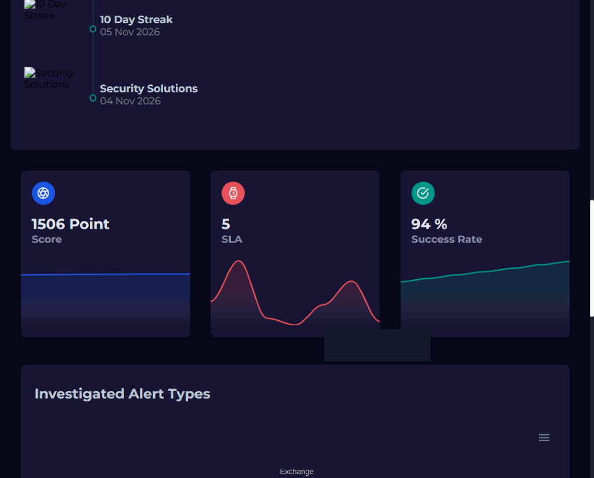
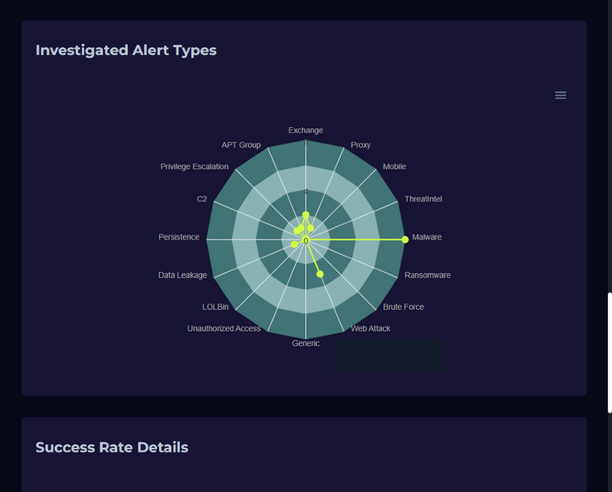
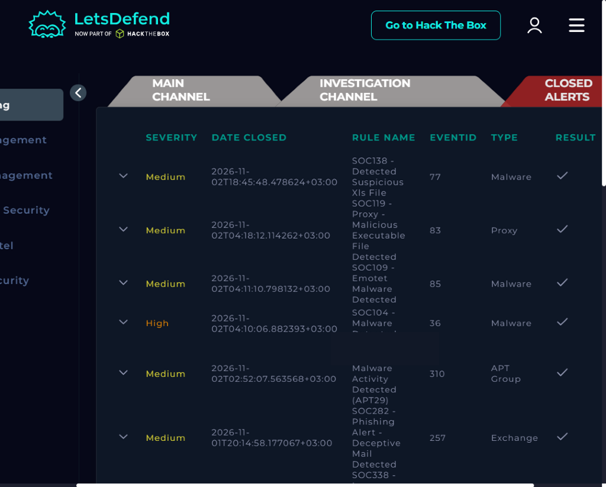
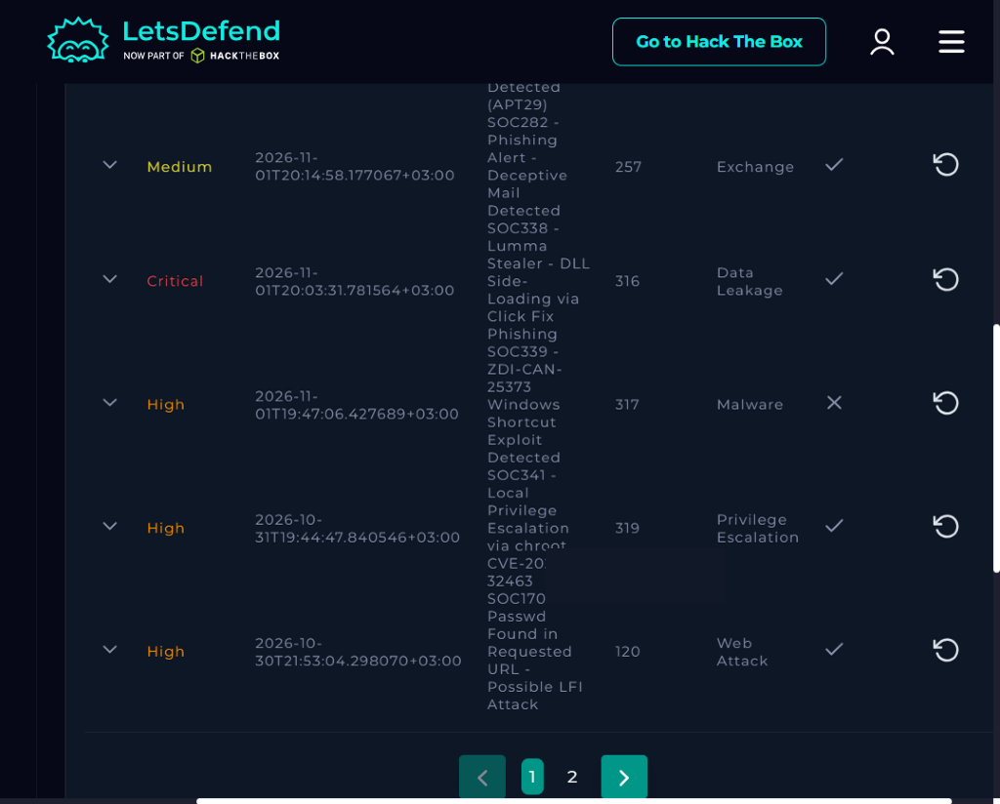

# 🛡️ LetsDefend SOC Analyst Portfolio & Incident Write-ups

[-00d2ff?style=for-the-badge&logo=hackthebox&logoColor=white)](https://app.letsdefend.io/user/mohmmad234)
[](https://app.letsdefend.io/user/mohmmad234)
[]()
[]()
[-orange?style=for-the-badge)](./learning-paths/SOC-Analyst-Learning-Path.md)
[](./learning-paths/SOC-Analyst-Learning-Path.md#3-verified-badges--achievements-15-total)

Welcome to my **Security Operations Center (SOC) Analyst & Incident Response Portfolio**. This repository documents my hands-on SIEM alert investigations, incident response playbooks, threat intelligence analysis, and structured training progress on **LetsDefend**.

Every alert write-up in this repository includes:
- **Executive Summary & Technical Telemetry** (Source/Destination IPs, Hostnames, Processes, Hashes, URLs, SMTP Headers, HTTP Requests)
- **Step-by-Step Investigation Methodology** (SIEM Log Management, EDR Process Trees, Email Gateways, Proxy Logs, Sandbox Analysis)
- **Defanged Indicators of Compromise (IOCs)** & **MITRE ATT&CK® TTP Mappings**
- **Playbook Answers & Analytical Post-Mortems**
- **Actionable Containment, Eradication & Hardening Recommendations**
- **Platform Verification Screenshots**

---

## 📊 1. Analyst Profile & Performance Metrics

| Metric | Verified Value |
| :--- | :--- |
| **Analyst Handle** | `mohmmad234` ([Public Profile](https://app.letsdefend.io/user/mohmmad234)) |
| **Total Platform Score** | **1,506 Points** |
| **Alert Classification Accuracy** | **94% Success Rate** (13 / 14 Closed Alerts Verified Correct) |
| **Average Response SLA** | **5** |
| **Investigated Alert Categories** | Malware, Web Attacks, APT Groups (APT29), Exchange/Phishing, Data Leakage (InfoStealers), Privilege Escalation, Proxy |
| **SOC Analyst Learning Path** | **60% Completed** (15 / 25 Modules Completed) |
| **Malware Analysis Skill Path** | **33% Completed** (3 / 9 Modules Active/Completed) |
| **Unlocked Platform Badges** | **15 Verified Badges** |

### Visual Profile & Performance Evidence

| Public Profile & Score | Investigated Alert Domains (Radar) |
| :---: | :---: |
|  |  |

---

## 🚨 2. Investigated SOC Alerts & Incident Write-ups (14 Total)

Click on any **Incident Report Link** below to view the full technical write-up, IOCs, MITRE ATT&CK mappings, playbook breakdown, and verification screenshots.

| # | Event ID | Alert Rule & Scenario | Severity | Category | Role | SLA (min) | Verdict & Result | Detailed Write-up |
| :-: | :-: | :--- | :-: | :--- | :--- | :-: | :-: | :--- |
| **01** | `77` | **SOC138 - Detected Suspicious Xls File** (`ORDER SHEET & SPEC.xlsm` Macro C2) | 🟡 Medium | Malware | Security Analyst | `1.15` | ✅ **True Positive** (67% Playbook) | [📄 View Report](./incidents/01-EventID-77-SOC138-Suspicious-Xls-File.md) |
| **02** | `83` | **SOC119 - Proxy - Malicious Executable File Detected** (`win-rar.com` Download Triage) | 🟡 Medium | Proxy | Security Analyst | `6.73` | ✅ **True Positive** (100% Playbook) | [📄 View Report](./incidents/02-EventID-83-SOC119-Proxy-Malicious-Executable.md) |
| **03** | `85` | **SOC109 - Emotet Malware Detected** (Banking Trojan & Macro Loader) | 🟡 Medium | Malware | Security Analyst | `0.37` | ✅ **True Positive** | [📄 View Report](./incidents/03-EventID-85-SOC109-Emotet-Malware-Detected.md) |
| **04** | `36` | **SOC104 - Malware Detected** (Endpoint Binary & C2 Triage) | 🟠 High | Malware | Security Analyst | `2.63` | ✅ **True Positive** | [📄 View Report](./incidents/04-EventID-36-SOC104-Malware-Detected.md) |
| **05** | `310` | **SOC332 - CosmicDuke Malware Activity Detected (APT29)** (`Chrome_updates.exe` Spearphishing) | 🟡 Medium | APT Group | Security Analyst | `19.50` | ✅ **True Positive** (80% Playbook) | [📄 View Report](./incidents/05-EventID-310-SOC332-CosmicDuke-APT29.md) |
| **06** | `257` | **SOC282 - Phishing Alert - Deceptive Mail Detected** (`Free Coffee Voucher` S3 Payload) | 🟡 Medium | Exchange | Security Analyst | `7.51` | ✅ **True Positive** (100% Playbook) | [📄 View Report](./incidents/06-EventID-257-SOC282-Phishing-Deceptive-Mail.md) |
| **07** | `316` | **SOC338 - Lumma Stealer - DLL Side-Loading via ClickFix Phishing** (`windows-update.site`) | 🔴 Critical | Data Leakage | Security Analyst | `15.51` | ✅ **True Positive** (83% Playbook) | [📄 View Report](./incidents/07-EventID-316-SOC338-Lumma-Stealer-ClickFix.md) |
| **08** | `317` | **SOC339 - ZDI-CAN-25373 Windows Shortcut Exploit Detected** (`2025AnnualReport.lnk`) | 🟠 High | Malware | Security Analyst | `7.69` | 🔍 **False Positive** *(Post-Mortem Included)* | [📄 View Report](./incidents/08-EventID-317-SOC339-ZDI-CAN-25373-Shortcut-Exploit.md) |
| **09** | `319` | **SOC341 - Local Privilege Escalation via chroot (CVE-2025-32463)** (`sudo -R woot woot`) | 🟠 High | Privilege Escalation | Incident Responder | `4.93` | ✅ **True Positive** (79% Playbook) | [📄 View Report](./incidents/09-EventID-319-SOC341-Linux-Chroot-CVE-2025-32463.md) |
| **10** | `120` | **SOC170 - Passwd Found in Requested URL - Possible LFI Attack** (`/etc/passwd` HTTP 500) | 🟠 High | Web Attack | Security Analyst | `0.40` | ✅ **True Positive** | [📄 View Report](./incidents/10-EventID-120-SOC170-Passwd-LFI-Web-Attack.md) |
| **11** | `320` | **SOC342 - CVE-2025-53770 SharePoint ToolShell Auth Bypass & RCE** (`ToolPane.aspx`) | 🔴 Critical | Web Attack | Incident Responder | `8.23` | ✅ **True Positive** (78% Playbook) | [📄 View Report](./incidents/11-EventID-320-SOC342-SharePoint-ToolShell-CVE-2025-53770.md) |
| **12** | `322` | **SOC344 - EDR Tampering Attempt via EDR-Freeze** (`EDR-Freeze_1.0.exe` Defender PID 6080) | 🟠 High | Malware | Incident Responder | `1.77` | ✅ **True Positive** (85% Playbook) | [📄 View Report](./incidents/12-EventID-322-SOC344-EDR-Tampering-EDR-Freeze.md) |
| **13** | `318` | **SOC340 - Apache Tomcat Serialized Payload RCE (CVE-2025-24813)** (`PUT /letsattack.session`) | 🔴 Critical | Web Attack | Incident Responder | `0.69` | ✅ **True Positive** | [📄 View Report](./incidents/13-EventID-318-SOC340-Tomcat-RCE-CVE-2025-24813.md) |
| **14** | `321` | **SOC343 - WinRAR Zero-Day Path Traversal Vulnerability (CVE-2025-8088)** | 🔴 Critical | Malware | Incident Responder | `1.22` | ✅ **True Positive** | [📄 View Report](./incidents/14-EventID-321-SOC343-WinRAR-ZeroDay-CVE-2025-8088.md) |

### Closed Alerts Dashboard Evidence

| Closed Alerts Queue (Part 1) | Closed Alerts Queue (Part 2) |
| :---: | :---: |
|  |  |

---

## 📚 3. SOC Analyst Learning Path & Training Reference

👉 **[Read the Full SOC Analyst & Malware Analysis Learning Path Reference](./learning-paths/SOC-Analyst-Learning-Path.md)**

### Summary of Completed Training Modules (15 / 25 in SOC Analyst Path — 60%)

1. ✅ **SOC Fundamentals** — L1/L2/L3 Operations, SIEM/EDR/SOAR Architecture, SLA Triage
2. ✅ **Cyber Kill Chain** — 7-Stage Intrusion Analysis & Defense-in-Depth Mapping
3. ✅ **MITRE ATT&CK Framework** — Adversary TTPs, Sub-Techniques & Threat Actor Profiling
4. ✅ **Phishing Email Analysis** — SMTP Header Forensics (`SPF`/`DKIM`/`DMARC`), Spoofing & Attachment Sandboxing
5. ✅ **Detecting Web Attacks** — SQLi, XSS, LFI/RFI, Command Injection & IDOR in HTTP Logs
6. ✅ **Detecting Web Attacks - 2** — Advanced Web Exploitation & HTTP Status/Response Verification
7. ✅ **Investigate Web Attack** — End-to-End Web Intrusion Correlation
8. ✅ **How to Investigate a SIEM Alert?** — Structured Triage, Asset Context & Threat Intel Enrichment
9. ✅ **Malware Analysis Fundamentals** — Static/Dynamic Triage, PE Inspection & Hash Reputation
10. ✅ **SA - Malware - Event ID: 77** — Practical Macro-Enabled Excel Malware Investigation
11. ✅ **Dynamic Malware Analysis** — Isolated Sandboxing, Process Trees, Registry & C2 Monitoring
12. ✅ **MSHTML** — CVE-2021-40444 Office ActiveX Exploitation Analysis
13. ✅ **Malicious Document Analysis** — OLE2/OOXML Inspection (`oledump`, `olevba`) & Macro Deobfuscation
14. ✅ **Security Solutions** — Enterprise Security Stack (Firewall, IDS/IPS, WAF, Proxy, EDR, DLP)
15. ✅ **Network Log Analysis** — PCAPs, Zeek/Suricata, DNS Exfiltration & Proxy Forensics


---

## 🗺️ 4. MITRE ATT&CK® Coverage Demonstrated Across Investigations

| Tactic | Techniques Investigated | Corresponding Incidents |
| :--- | :--- | :--- |
| **Initial Access (`TA0001`)** | `T1566.001` Spearphishing Attachment, `T1566.002` Spearphishing Link, `T1190` Exploit Public-Facing Application | EventIDs `257`, `310`, `316`, `318`, `320`, `321` |
| **Execution (`TA0002`)** | `T1059.001` PowerShell, `T1059.003` Windows Command Shell, `T1059.004` Unix Shell, `T1204.002` Malicious File, `T1204.004` ClickFix Copy-Paste, `T1203` Client Exploitation | EventIDs `77`, `83`, `85`, `310`, `316`, `317`, `319`, `321` |
| **Persistence (`TA0003`)** | `T1547.001` Registry Run Keys / Startup Folder, `T1053.005` Scheduled Task, `T1543.003` Windows Service, `T1505.003` Web Shell | EventIDs `310`, `320`, `321` |
| **Privilege Escalation (`TA0004`)** | `T1548.003` Sudo and Sudo Caching (`CVE-2025-32463`), `T1078` Valid Accounts | EventID `319` |
| **Defense Evasion (`TA0005`)** | `T1562.001` Impair Defenses (`EDR-Freeze`), `T1574.002` DLL Side-Loading, `T1112` Modify Registry, `T1027` Obfuscated Files, `T1036` Masquerading (`ZDI-CAN-25373`) | EventIDs `77`, `316`, `317`, `322` |
| **Discovery (`TA0007`)** | `T1012` Query Registry, `T1057` Process Discovery, `T1082` System Information Discovery | EventID `310` |
| **Command & Control (`TA0011`)** | `T1105` Ingress Tool Transfer, `T1071.001` Web Protocols | EventIDs `77`, `85`, `257`, `310`, `316` |

---

## 📂 5. Repository Structure

```text
LetsDefend-SOC-Portfolio/
├── README.md                                                     # Main Portfolio Dashboard & Index
├── learning-paths/
│   └── SOC-Analyst-Learning-Path.md                              # Detailed SOC & Malware Path Reference (60% / 15 Modules + 15 Badges)
├── incidents/
│   ├── 01-EventID-77-SOC138-Suspicious-Xls-File.md               # Macro-Enabled Excel Dropper & C2
│   ├── 02-EventID-83-SOC119-Proxy-Malicious-Executable.md        # Proxy Executable Download Analysis
│   ├── 03-EventID-85-SOC109-Emotet-Malware-Detected.md           # Emotet Trojan Triage
│   ├── 04-EventID-36-SOC104-Malware-Detected.md                  # High-Severity Endpoint Malware Triage
│   ├── 05-EventID-310-SOC332-CosmicDuke-APT29.md                 # APT29 CosmicDuke Spearphishing & Persistence
│   ├── 06-EventID-257-SOC282-Phishing-Deceptive-Mail.md          # Exchange Phishing Triage & Containment
│   ├── 07-EventID-316-SOC338-Lumma-Stealer-ClickFix.md           # Lumma Stealer via ClickFix & DLL Side-Loading
│   ├── 08-EventID-317-SOC339-ZDI-CAN-25373-Shortcut-Exploit.md   # ZDI-CAN-25373 Windows .LNK Whitespace Exploit
│   ├── 09-EventID-319-SOC341-Linux-Chroot-CVE-2025-32463.md      # Linux Sudo chroot LPE (CVE-2025-32463)
│   ├── 10-EventID-120-SOC170-Passwd-LFI-Web-Attack.md            # Web Server LFI (/etc/passwd) Triage
│   ├── 11-EventID-320-SOC342-SharePoint-ToolShell-CVE-2025-53770.md # SharePoint ToolShell Auth Bypass & RCE
│   ├── 12-EventID-322-SOC344-EDR-Tampering-EDR-Freeze.md         # EDR-Freeze WerFaultSecure PPL Suspension
│   ├── 13-EventID-318-SOC340-Tomcat-RCE-CVE-2025-24813.md        # Apache Tomcat Partial PUT Deserialization RCE
│   └── 14-EventID-321-SOC343-WinRAR-ZeroDay-CVE-2025-8088.md     # WinRAR Zero-Day Path Traversal (CVE-2025-8088)
└── assets/
    └── screenshots/
        ├── profile/                                              # Verified Profile, Score, SLA & Badges Screenshots
        ├── alerts/                                               # Closed Alerts Queue & Expanded Playbook Screenshots
        └── learning-paths/                                       # SOC Analyst & Malware Skill Path Progress Screenshots
```
