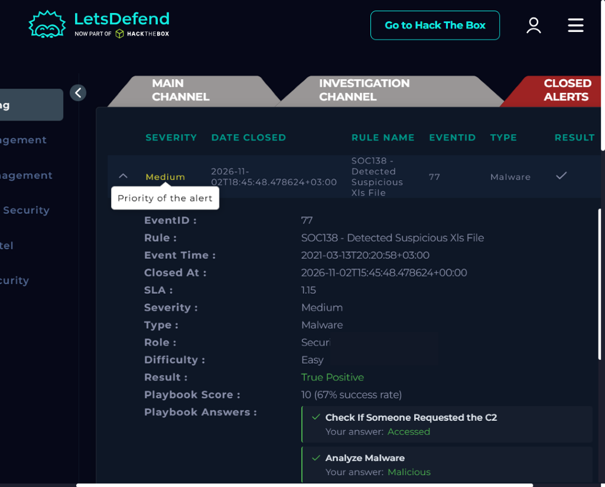

# EventID 77 — SOC138: Detected Suspicious Xls File

> **[⬅️ Back to Main Portfolio README](../README.md)** | **[📚 View SOC Learning Path Progress](../learning-paths/SOC-Analyst-Learning-Path.md)**

---

## 📋 1. Incident Overview & Triage Metadata

| Field | Value |
| :--- | :--- |
| **Event ID** | `77` |
| **Alert Rule** | `SOC138 - Detected Suspicious Xls File` |
| **Severity** | **Medium** |
| **Alert Category / Type** | `Malware` |
| **Assigned Role & Difficulty** | `Security Analyst` (`Easy`) |
| **Event Timestamp** | `2021-03-13 20:20:58 +03:00` |
| **Alert Closed Timestamp** | `2026-11-02 15:45:48 UTC` |
| **Response SLA (Minutes)** | `1.15` |
| **Final Analyst Verdict** | **True Positive** |
| **Playbook Score** | **10 pts (67% Success Rate)** |

---

## 🎯 2. Executive Summary

A Medium-severity alert (`SOC138`) was triggered on host **Sofia** (`172.16.17.56`) after a suspicious macro-enabled Microsoft Excel file named `ORDER SHEET & SPEC.xlsm` was detected and allowed to execute. Threat intelligence and dynamic sandbox analysis confirmed that the document contained malicious VBA macros designed to modify system registry keys (`T1112`) and initiate outbound Command-and-Control (C2) communication.

---

## 🔍 3. Technical Alert Telemetry

| Telemetry Attribute | Recorded Value |
| :--- | :--- |
| **Source Hostname** | `Sofia` |
| **Source IP Address** | `172.16.17.56` |
| **File Name** | `ORDER SHEET & SPEC.xlsm` (2.66 MB) |
| **File MD5 Hash** | `7ccf88c0bbe3b29bf19d877c4596a8d4` |
| **Device Action** | `Allowed` |
| **MITRE ATT&CK Technique** | `T1112` — Modify Registry / `T1204.002` — Malicious File |

---

## 🛠️ 4. Step-by-Step Investigation Methodology

1. **Alert Triage & Asset Verification:** Inspected the triggered SIEM alert for EventID `77` on endpoint `Sofia` (`172.16.17.56`). Noted that the device action was `Allowed`, meaning the endpoint security agent did not automatically quarantine the file.
2. **Static & OSINT Hash Analysis:** Extracted the MD5 hash `7ccf88c0bbe3b29bf19d877c4596a8d4` for `ORDER SHEET & SPEC.xlsm` and queried VirusTotal and Hybrid Analysis. Multiple AV engines flagged the `.xlsm` file as a malicious macro-enabled Office dropper.
3. **Network & C2 Log Correlation:** Filtered proxy and firewall logs in Log Management by source IP `172.16.17.56` around `2021-03-13 20:20:58`. Confirmed outbound HTTP/HTTPS requests to external C2 infrastructure initiated immediately after the Excel document was opened.
4. **Endpoint Forensics (EDR):** Checked Process History and Network Connections on host `Sofia` in the EDR console, verifying that `EXCEL.EXE` spawned child processes and modified registry keys (`T1112`).

---

## 🚨 5. Indicators of Compromise (IOCs)

| Indicator Type | Value (Defanged) | Context / Description |
| :--- | :--- | :--- |
| **MD5 Hash** | `7ccf88c0bbe3b29bf19d877c4596a8d4` | Malicious macro-enabled Excel document (`ORDER SHEET & SPEC.xlsm`) |
| **Filename** | `ORDER SHEET & SPEC.xlsm` | Weaponized Office attachment |
| **Internal Host** | `172.16.17.56` (`Sofia`) | Compromised internal workstation |

---

## 📝 6. Playbook Execution & Analytical Breakdown

| Playbook Question / Phase | Analyst Selection | Official Playbook Answer | Status & Notes |
| :--- | :--- | :--- | :--- |
| **Check If Someone Requested the C2** | `Accessed` | `Accessed` | ✅ Correct |
| **Analyze Malware** | `Malicious` | `Malicious` | ✅ Correct |
| **Check If Malware Is Quarantined/Cleaned** | `Quarantined` | `Not Quarantined` (Device Action was `Allowed`) | ⚠️ Review Note: Always cross-check `Device Action: Allowed` before marking quarantined. |

---

## 🛡️ 7. Containment, Eradication & Remediation Recommendations

- **Immediate Host Isolation:** Isolate workstation `Sofia` (`172.16.17.56`) via EDR to sever active C2 communications.
- **Eradication:** Terminate malicious child processes spawned by `EXCEL.EXE`, remove `ORDER SHEET & SPEC.xlsm`, and revert unauthorized registry modifications.
- **Policy Hardening:** Configure Group Policy (GPO) to block VBA macros from running in Office files downloaded from the internet (Mark-of-the-Web / MOTW).

---

## 📸 8. Platform Verification Screenshot

