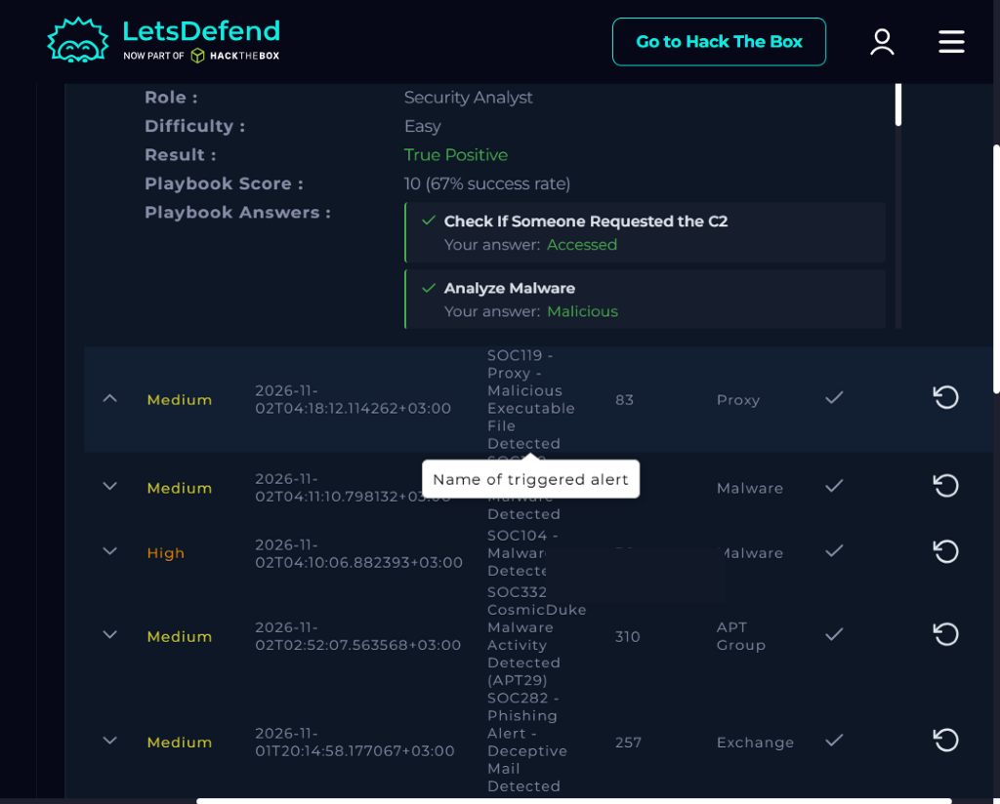

# EventID 83 — SOC119: Proxy - Malicious Executable File Detected

> **[⬅️ Back to Main Portfolio README](../README.md)** | **[📚 View SOC Learning Path Progress](../learning-paths/SOC-Analyst-Learning-Path.md)**

---

## 📋 1. Incident Overview & Triage Metadata

| Field | Value |
| :--- | :--- |
| **Event ID** | `83` |
| **Alert Rule** | `SOC119 - Proxy - Malicious Executable File Detected` |
| **Severity** | **Medium** |
| **Alert Category / Type** | `Proxy` |
| **Assigned Role & Difficulty** | `Security Analyst` (`Easy`) |
| **Event Timestamp** | `2021-03-18 14:12:00 +03:00` |
| **Alert Closed Timestamp** | `2026-11-02 01:18:12 UTC` |
| **Response SLA (Minutes)** | `6.73` |
| **Final Analyst Verdict** | **True Positive (Correct Classification — 100% Playbook Score)** |
| **Playbook Score** | **5 pts (100% Success Rate)** |

---

## 🎯 2. Executive Summary

A Medium-severity proxy alert (`SOC119`) was generated when user **Susie** on host **SusieHost** (`172.16.17.5`) downloaded a 32-bit executable installer from `https://www.win-rar.com/postdownload.html?&L=0&Version=32bit`. Investigation of the domain, destination IP (`51.195.68.163`), and downloaded binary confirmed that the traffic was a legitimate download of the official WinRAR utility rather than a malicious payload.

---

## 🔍 3. Technical Alert Telemetry

| Telemetry Attribute | Recorded Value |
| :--- | :--- |
| **Source Hostname** | `SusieHost` (User: `Susie`) |
| **Source IP Address** | `172.16.17.5` |
| **Destination IP Address** | `51.195.68.163` |
| **Destination URL** | `https://www.win-rar.com/postdownload.html?&L=0&Version=32bit` |
| **Device Action** | `Allowed` |
| **MITRE ATT&CK Technique** | `T1204` — User Execution |

---

## 🛠️ 4. Step-by-Step Investigation Methodology

1. **Alert Triage:** Reviewed the proxy alert details for EventID `83` triggered by an executable download over HTTPS from `win-rar.com`.
2. **URL & Domain Reputation Analysis:** Checked `www.win-rar.com` and destination IP `51.195.68.163` across VirusTotal, AbuseIPDB, and WHOIS records. Confirmed that `win-rar.com` is the official distribution domain for WinRAR GmbH.
3. **Endpoint Verification:** Inspected `SusieHost` (`172.16.17.5`) in Endpoint Security to verify the binary signature and ensure no anomalous child processes or unauthorized network connections occurred after installation.

---

## 🚨 5. Indicators of Compromise (IOCs)

| Indicator Type | Value (Defanged) | Context / Description |
| :--- | :--- | :--- |
| **URL** | `https://www.win-rar.com/postdownload.html?&L=0&Version=32bit` | Official WinRAR 32-bit installer download page (Benign) |
| **Destination IP** | `51.195.68.163` | Legitimate hosting server for `win-rar.com` |
| **Internal Host** | `172.16.17.5` (`SusieHost`) | Endpoint initiating standard software download |

---

## 📝 6. Playbook Execution & Analytical Breakdown

| Playbook Question / Phase | Analyst Selection | Official Playbook Answer | Status & Notes |
| :--- | :--- | :--- | :--- |
| **Analyze URL Address** | `Non-malicious` | `Non-malicious` | ✅ Correct (100%) |

---

## 🛡️ 7. Containment, Eradication & Remediation Recommendations

- **Rule Tuning:** Whitelist verified software vendor domains or require standard software installations to be provisioned through an internal Software Center / SCCM catalog to reduce proxy rule noise.

---

## 📸 8. Platform Verification Screenshot

