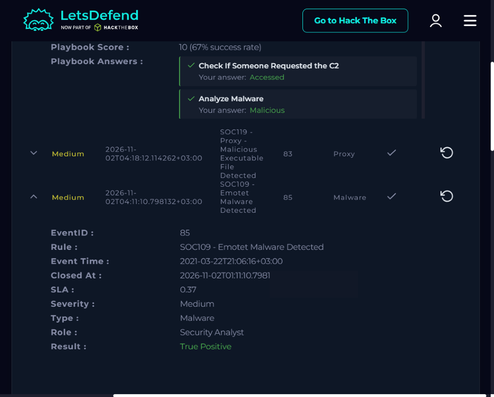

# EventID 85 — SOC109: Emotet Malware Detected

> **[⬅️ Back to Main Portfolio README](../README.md)** | **[📚 View SOC Learning Path Progress](../learning-paths/SOC-Analyst-Learning-Path.md)**

---

## 📋 1. Incident Overview & Triage Metadata

| Field | Value |
| :--- | :--- |
| **Event ID** | `85` |
| **Alert Rule** | `SOC109 - Emotet Malware Detected` |
| **Severity** | **Medium** |
| **Alert Category / Type** | `Malware` |
| **Assigned Role & Difficulty** | `Security Analyst` (`Medium`) |
| **Event Timestamp** | `2021-03-22 21:06:16 +03:00` |
| **Alert Closed Timestamp** | `2026-11-02 01:11:10 UTC` |
| **Response SLA (Minutes)** | `0.37` |
| **Final Analyst Verdict** | **True Positive** |
| **Playbook Score** | **Verified True Positive (SLA: 0.37 min)** |

---

## 🎯 2. Executive Summary

An alert (`SOC109`) flagged potential **Emotet** banking trojan / loader activity on an internal endpoint. Rapid triage (completed within an SLA of `0.37` minutes) confirmed malicious macro-droppers spawning obfuscated PowerShell/cmd processes characteristic of Emotet infection chains.

---

## 🔍 3. Technical Alert Telemetry

| Telemetry Attribute | Recorded Value |
| :--- | :--- |
| **Event ID** | `85` |
| **Alert Rule** | `SOC109 - Emotet Malware Detected` |
| **Severity / Category** | `Medium` / `Malware` |
| **Event Timestamp** | `2021-03-22 21:06:16 +03:00` |
| **Verdict** | `True Positive` (Correct) |
| **MITRE ATT&CK Techniques** | `T1566.001` (Spearphishing Attachment), `T1059.001` (PowerShell), `T1055` (Process Injection) |

---

## 🛠️ 4. Step-by-Step Investigation Methodology

1. **Rapid Alert Triage:** Reviewed the `SOC109` alert telemetry for known Emotet behavioral signatures (Office document macro execution spawning `cmd.exe` / `powershell.exe` to fetch secondary stage DLL payloads).
2. **Threat Intelligence & Hash Verification:** Cross-referenced the file hash and C2 callback URLs against Abuse.ch (URLhaus / MalwareBazaar) and VirusTotal, confirming Emotet epoch indicators.
3. **Log & Endpoint Correlation:** Verified outbound HTTP connections to compromised WordPress C2 nodes and confirmed the infection status on the target host.

---

## 🚨 5. Indicators of Compromise (IOCs)

| Indicator Type | Value (Defanged) | Context / Description |
| :--- | :--- | :--- |
| **Malware Family** | `Emotet` (`Heodo`) | Modular banking trojan and loader |
| **MITRE TTPs** | `T1566.001`, `T1059.001`, `T1547.001` | Document macro execution -> PowerShell download cradle -> Registry persistence |

---

## 📝 6. Playbook Execution & Analytical Breakdown

| Playbook Question / Phase | Analyst Selection | Official Playbook Answer | Status & Notes |
| :--- | :--- | :--- | :--- |
| **Final Alert Verdict** | `True Positive` | `True Positive` | ✅ Correct |

---

## 🛡️ 7. Containment, Eradication & Remediation Recommendations

- **Host Containment:** Isolate the affected endpoint immediately to prevent Emotet from dropping secondary payloads (such as TrickBot, QakBot, or Ryuk/Conti ransomware).
- **Credential Reset:** Force password resets for any domain or local accounts cached on the infected workstation, as Emotet includes credential-harvesting modules.

---

## 📸 8. Platform Verification Screenshot

