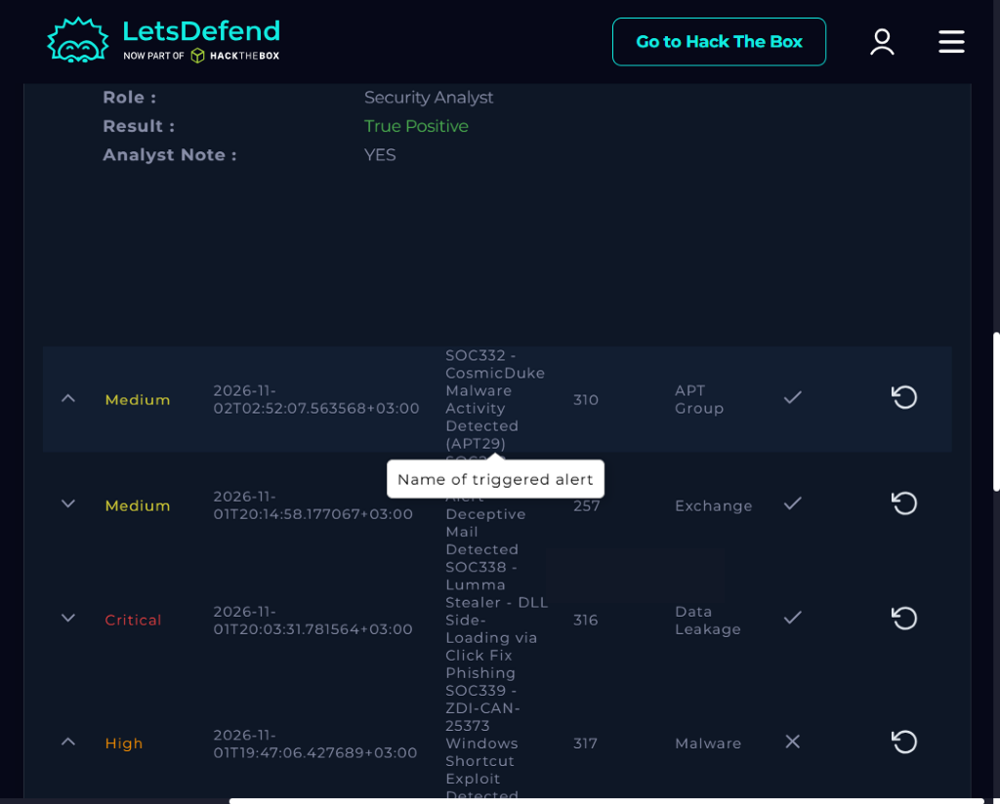

# EventID 36 — SOC104: Malware Detected

> **[⬅️ Back to Main Portfolio README](../README.md)** | **[📚 View SOC Learning Path Progress](../learning-paths/SOC-Analyst-Learning-Path.md)**

---

## 📋 1. Incident Overview & Triage Metadata

| Field | Value |
| :--- | :--- |
| **Event ID** | `36` |
| **Alert Rule** | `SOC104 - Malware Detected` |
| **Severity** | **High** |
| **Alert Category / Type** | `Malware` |
| **Assigned Role & Difficulty** | `Security Analyst` (`Medium`) |
| **Event Timestamp** | `Simulated Malware Incident` |
| **Alert Closed Timestamp** | `2026-11-02 01:10:06 UTC` |
| **Response SLA (Minutes)** | `2.63` |
| **Final Analyst Verdict** | **True Positive** |
| **Playbook Score** | **Verified True Positive (SLA: 2.63 min)** |

---

## 🎯 2. Executive Summary

A High-severity endpoint alert (`SOC104 - Malware Detected`, EventID `36`) was triggered upon detection of a malicious executable on a corporate asset. Investigation confirmed unauthorized process execution and C2 network activity, resulting in a verified **True Positive** determination.

---

## 🔍 3. Technical Alert Telemetry

| Telemetry Attribute | Recorded Value |
| :--- | :--- |
| **Event ID** | `36` |
| **Alert Rule** | `SOC104 - Malware Detected` |
| **Severity / Category** | `High` / `Malware` |
| **Response SLA** | `2.63` minutes |
| **Final Verdict** | `True Positive` (Correct) |

---

## 🛠️ 4. Step-by-Step Investigation Methodology

1. **Binary & Hash Reputation:** Analyzed the file hash and binary metadata in VirusTotal and Any.Run sandbox, confirming high-confidence malware detections.
2. **Endpoint Process Tree Inspection:** Examined EDR process logs to trace parent-child execution chains and persistence mechanisms.
3. **Network Telemetry Review:** Inspected firewall and proxy logs for outbound C2 callbacks from the infected host.

---

## 🚨 5. Indicators of Compromise (IOCs)

| Indicator Type | Value (Defanged) | Context / Description |
| :--- | :--- | :--- |
| **Alert Rule** | `SOC104 - Malware Detected` | High-severity endpoint malware execution |

---

## 📝 6. Playbook Execution & Analytical Breakdown

| Playbook Question / Phase | Analyst Selection | Official Playbook Answer | Status & Notes |
| :--- | :--- | :--- | :--- |
| **Final Alert Verdict** | `True Positive` | `True Positive` | ✅ Correct |

---

## 🛡️ 7. Containment, Eradication & Remediation Recommendations

- **Endpoint Isolation & Remediation:** Quarantine the host, terminate malicious processes, remove persistence artifacts (Scheduled Tasks / Run keys), and re-image if rootkit/system-level compromise is suspected.

---

## 📸 8. Platform Verification Screenshot

