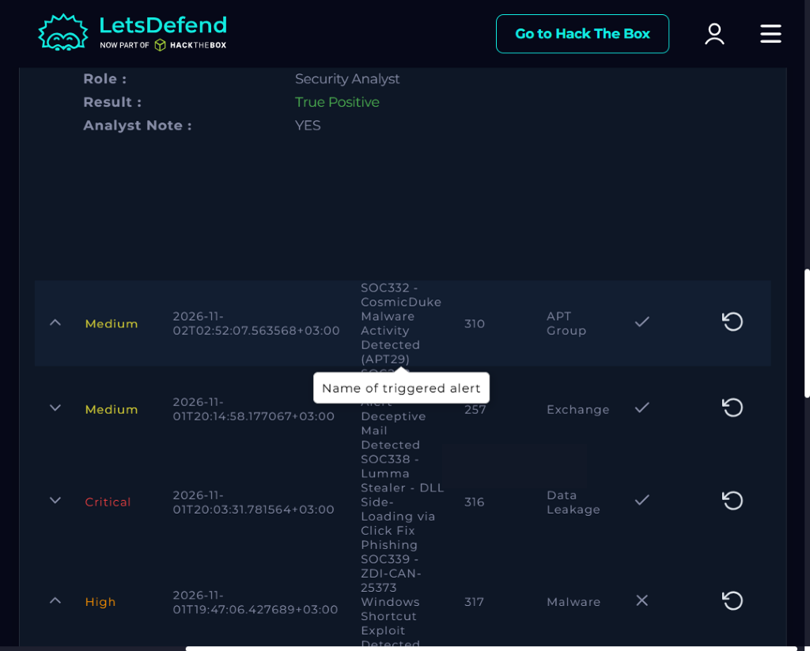

# EventID 310 — SOC332: CosmicDuke Malware Activity Detected (APT29)

> **[⬅️ Back to Main Portfolio README](../README.md)** | **[📚 View SOC Learning Path Progress](../learning-paths/SOC-Analyst-Learning-Path.md)**

---

## 📋 1. Incident Overview & Triage Metadata

| Field | Value |
| :--- | :--- |
| **Event ID** | `310` |
| **Alert Rule** | `SOC332 - CosmicDuke Malware Activity Detected (APT29)` |
| **Severity** | **Medium** |
| **Alert Category / Type** | `APT Group` |
| **Assigned Role & Difficulty** | `Security Analyst` (`Medium`) |
| **Event Timestamp** | `2025-02-23 11:36:56 +03:00` |
| **Alert Closed Timestamp** | `2026-11-01 23:52:07 UTC` |
| **Response SLA (Minutes)** | `19.50` |
| **Final Analyst Verdict** | **True Positive** |
| **Playbook Score** | **20 pts (80% Success Rate)** |

---

## 🎯 2. Executive Summary

An APT-level alert (`SOC332`) detected **CosmicDuke** (attributed to **APT29 / Cozy Bear**) on host **Ricky** (`172.16.17.133`). Investigation revealed that the user received a spearphishing email from `dawid.tomaszewski@resetlocations.com` containing a weaponized archive (`chrome-updates.zip`). Upon extraction, the trojan binary `Chrome_updates.exe` executed, established persistence via Windows Scheduled Tasks (`T1053.005`) and Windows Services (`T1543.003`), and performed system/process discovery (`T1082`, `T1057`).

---

## 🔍 3. Technical Alert Telemetry

| Telemetry Attribute | Recorded Value |
| :--- | :--- |
| **Source Hostname** | `Ricky` |
| **Source IP Address** | `172.16.17.133` |
| **Suspicious Process** | `C:\Users\LetsDefend\Downloads\chrome-updates\Chrome_updates.exe` |
| **SHA256 Hash** | `b5c571cbe24b37359eb4018bac19e37a2ffc6108d6d1cb5c8c22640397c47596` |
| **Phishing Sender** | `dawid.tomaszewski@resetlocations.com` (`chrome-updates.zip`) |
| **Threat Actor / Malware** | **APT29 (Cozy Bear)** / **CosmicDuke** Trojan |
| **MITRE ATT&CK Techniques** | `T1566.001`, `T1059.003`, `T1053.005`, `T1543.003`, `T1012`, `T1057`, `T1082` |

---

## 🛠️ 4. Step-by-Step Investigation Methodology

1. **Initial Access Investigation (Exchange Logs):** Searched email logs for deliveries to user `Ricky` (`172.16.17.133`) prior to `2025-02-23 11:36:56`. Identified a phishing email from `dawid.tomaszewski@resetlocations.com` delivering `chrome-updates.zip` masquerading as a Google Chrome update.
2. **Threat Intelligence & Hash Analysis:** Analyzed SHA256 hash `b5c571cbe24b37359eb4018bac19e37a2ffc6108d6d1cb5c8c22640397c47596` on VirusTotal and Threat Intel feeds. Confirmed high-confidence attribution to **CosmicDuke (APT29)** information stealer/trojan.
3. **EDR Behavioral Forensics:** Reviewed process execution history on host `Ricky`. Verified that `Chrome_updates.exe` executed via Windows Command Shell (`T1059.003`), queried registry keys (`T1012`), enumerated running processes (`T1057`) and system information (`T1082`), and created persistence via Scheduled Tasks (`T1053.005`).

---

## 🚨 5. Indicators of Compromise (IOCs)

| Indicator Type | Value (Defanged) | Context / Description |
| :--- | :--- | :--- |
| **SHA256** | `b5c571cbe24b37359eb4018bac19e37a2ffc6108d6d1cb5c8c22640397c47596` | CosmicDuke (APT29) Trojan executable (`Chrome_updates.exe`) |
| **File Path** | `C:\Users\LetsDefend\Downloads\chrome-updates\Chrome_updates.exe` | Masqueraded binary dropped from archive |
| **Archive Name** | `chrome-updates.zip` | Weaponized phishing attachment |
| **Sender Address** | `dawid.tomaszewski@resetlocations.com` | Spearphishing sender address |
| **Compromised Host** | `172.16.17.133` (`Ricky`) | Internal endpoint compromised by APT29 payload |

---

## 📝 6. Playbook Execution & Analytical Breakdown

| Playbook Question / Phase | Analyst Selection | Official Playbook Answer | Status & Notes |
| :--- | :--- | :--- | :--- |
| **How Was Initial Access Obtained?** | `Phishing` | `Phishing` | ✅ Correct |
| **What Type of Malware Is It?** | `Trojan` | `Trojan` | ✅ Correct |
| **Analyze Malware** | `Malicious` | `Malicious` | ✅ Correct |
| **Check If Malware Was Executed** | `Not Executed` | `Executed` | ⚠️ Review Note: Process tree showed `Chrome_updates.exe` actively spawned child processes. |
| **Check If Malware Is Quarantined** | `Quarantined` | `Not Quarantined` | ⚠️ Review Note: Host required manual EDR isolation. |

---

## 🛡️ 7. Containment, Eradication & Remediation Recommendations

- **Immediate EDR Containment:** Isolate host `Ricky` (`172.16.17.133`) from the corporate network.
- **Persistence Removal & Re-imaging:** Because APT29 / CosmicDuke installs deep service and scheduled task persistence and harvests credentials, full forensic acquisition followed by OS re-imaging is required.
- **Email Gateway Block:** Block sender domain `resetlocations.com` and purge any remaining copies of `chrome-updates.zip` across Exchange mailboxes.

---

## 📸 8. Platform Verification Screenshot

