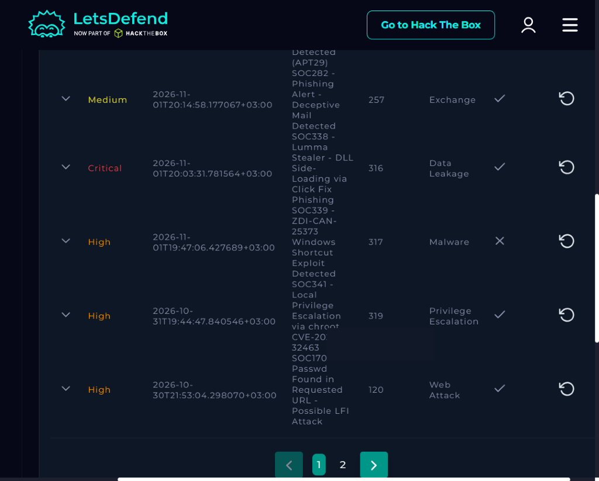

# EventID 257 — SOC282: Phishing Alert - Deceptive Mail Detected

> **[⬅️ Back to Main Portfolio README](../README.md)** | **[📚 View SOC Learning Path Progress](../learning-paths/SOC-Analyst-Learning-Path.md)**

---

## 📋 1. Incident Overview & Triage Metadata

| Field | Value |
| :--- | :--- |
| **Event ID** | `257` |
| **Alert Rule** | `SOC282 - Phishing Alert - Deceptive Mail Detected` |
| **Severity** | **Medium** |
| **Alert Category / Type** | `Exchange` |
| **Assigned Role & Difficulty** | `Security Analyst` (`Easy`) |
| **Event Timestamp** | `2024-06-24 02:39:05 +03:00` |
| **Alert Closed Timestamp** | `2026-11-01 17:14:58 UTC` |
| **Response SLA (Minutes)** | `7.51` |
| **Final Analyst Verdict** | **True Positive (100% Playbook Score)** |
| **Playbook Score** | **20 pts (100% Success Rate)** |

---

## 🎯 2. Executive Summary

An Exchange email security alert (`SOC282`, EventID `257`) detected a deceptive phishing email with subject **`Free Coffee Voucher`** sent from `free@coffeeshooop.com` (SMTP `103.80.134.63`) to internal user `Felix@letsdefend.io`. The email contained a malicious external link (`https://files-ld.s3.us-east-2.amazonaws[.]com/free-coffee.zip`). Investigation confirmed that the email was delivered to Felix's inbox, the user clicked the link, downloaded and executed the archive payload on his workstation, prompting immediate email deletion and host containment.

---

## 🔍 3. Technical Alert Telemetry

| Telemetry Attribute | Recorded Value |
| :--- | :--- |
| **SMTP Source IP** | `103.80.134.63` |
| **Sender Address** | `free@coffeeshooop.com` (Lookalike/Typosquatted Domain) |
| **Recipient Address** | `Felix@letsdefend.io` |
| **Email Subject** | `Free Coffee Voucher` |
| **Embedded Phishing URL** | `https://files-ld.s3.us-east-2.amazonaws[.]com/free-coffee.zip` |
| **Device Action** | `Allowed` (Delivered to Inbox) |
| **MITRE ATT&CK Techniques** | `T1566`, `T1566.002` (Spearphishing Link), `T1204` (User Execution), `T1059` |

---

## 🛠️ 4. Step-by-Step Investigation Methodology

1. **Email Header & Content Triage:** Inspected Exchange logs for EventID `257`. Identified social engineering lures (`Free Coffee Voucher`) sent from typosquatted domain `coffeeshooop.com` via external SMTP server `103.80.134.63`.
2. **URL & Payload Sandbox Analysis:** Extracted URL `https://files-ld.s3.us-east-2.amazonaws.com/free-coffee.zip` and analyzed the hosted archive in VirusTotal and sandbox environments. Confirmed the archive contained a malicious trojan executable.
3. **User Interaction & Proxy Correlation:** Queried Proxy and Endpoint logs for recipient `Felix@letsdefend.io`. Confirmed outbound HTTP GET request to `files-ld.s3.us-east-2.amazonaws.com/free-coffee.zip` and subsequent execution on Felix's host.
4. **Containment Action:** Deleted the phishing email from `Felix@letsdefend.io`'s Exchange mailbox and initiated endpoint remediation.

---

## 🚨 5. Indicators of Compromise (IOCs)

| Indicator Type | Value (Defanged) | Context / Description |
| :--- | :--- | :--- |
| **SMTP IP** | `103.80.134.63` | External mail server used to send phishing lure |
| **Sender Email** | `free@coffeeshooop.com` | Deceptive sender address |
| **Malicious URL** | `https://files-ld.s3.us-east-2.amazonaws[.]com/free-coffee.zip` | S3 bucket hosting malicious ZIP payload |
| **Target User** | `Felix@letsdefend.io` | Targeted corporate mailbox |

---

## 📝 6. Playbook Execution & Analytical Breakdown

| Playbook Question / Phase | Analyst Selection | Official Playbook Answer | Status & Notes |
| :--- | :--- | :--- | :--- |
| **Are There Attachments or URLs in the Email?** | `Yes` | `Yes` | ✅ Correct |
| **Analyze Attachment / URL** | `Malicious` | `Malicious` | ✅ Correct |
| **Check If Mail Was Delivered to User** | `Delivered` | `Delivered` | ✅ Correct |
| **Delete Email From Recipient** | `Deleted` | `Deleted` | ✅ Correct |
| **Check If Someone Opened the Malicious File/URL** | `Opened` | `Opened` | ✅ Correct (100% Playbook Score) |

---

## 🛡️ 7. Containment, Eradication & Remediation Recommendations

- **Mailbox Purge:** Completed hard deletion of the email from `Felix@letsdefend.io`'s inbox.
- **Endpoint Isolation:** Isolate Felix's workstation and terminate processes spawned from `free-coffee.zip`.
- **Perimeter Blocking:** Block SMTP IP `103.80.134.63`, sender domain `coffeeshooop.com`, and the malicious S3 URL at the Secure Email Gateway (SEG) and Web Proxy.

---

## 📸 8. Platform Verification Screenshot

