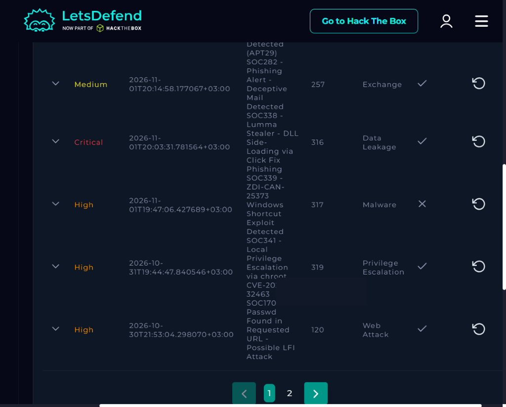

# EventID 316 — SOC338: Lumma Stealer - DLL Side-Loading via ClickFix Phishing

> **[⬅️ Back to Main Portfolio README](../README.md)** | **[📚 View SOC Learning Path Progress](../learning-paths/SOC-Analyst-Learning-Path.md)**

---

## 📋 1. Incident Overview & Triage Metadata

| Field | Value |
| :--- | :--- |
| **Event ID** | `316` |
| **Alert Rule** | `SOC338 - Lumma Stealer - DLL Side-Loading via Click Fix Phishing` |
| **Severity** | **Critical** |
| **Alert Category / Type** | `Data Leakage` |
| **Assigned Role & Difficulty** | `Security Analyst` (`Medium`) |
| **Event Timestamp** | `2025-06-11 08:23:18 +03:00` |
| **Alert Closed Timestamp** | `2026-11-01 17:03:31 UTC` |
| **Response SLA (Minutes)** | `15.51` |
| **Final Analyst Verdict** | **True Positive** |
| **Playbook Score** | **15 pts (83% Success Rate)** |

---

## 🎯 2. Executive Summary

A Critical-severity alert (`SOC338`, EventID `316`) detected a **ClickFix** social engineering phishing campaign delivering **Lumma Stealer** via DLL Side-Loading (`T1574.002`). User `dylan@letsdefend.io` received a deceptive email titled **`Upgrade your system to Windows 11 Pro for FREE`** from `update@windows-update.site` (SMTP `132.232.40.201`). The embedded link (`https://windows-update.site/`) prompted the user to copy-paste an obfuscated PowerShell/mshta command into the Windows Run dialog (`Win + R`), pulling down a side-loaded DLL payload to exfiltrate browser credentials and session tokens.

---

## 🔍 3. Technical Alert Telemetry

| Telemetry Attribute | Recorded Value |
| :--- | :--- |
| **SMTP Source IP** | `132.232.40.201` |
| **Sender Address** | `update@windows-update.site` |
| **Recipient Address** | `dylan@letsdefend.io` |
| **Email Subject** | `Upgrade your system to Windows 11 Pro for FREE` |
| **Phishing Domain** | `https://windows-update[.]site/` |
| **Malware Family** | **Lumma Stealer** (InfoStealer) |
| **MITRE ATT&CK Techniques** | `T1566.002`, `T1204.004` (ClickFix / Malicious Copy-Paste), `T1059.001`, `T1574` (DLL Side-Loading), `T1027`, `T1105` |

---

## 🛠️ 4. Step-by-Step Investigation Methodology

1. **Email Gateway Inspection:** Examined EventID `316` showing an allowed email from `update@windows-update.site` to `dylan@letsdefend.io` containing a fake Windows 11 upgrade lure.
2. **Domain & Threat Intel Analysis:** Investigated `windows-update.site` and SMTP IP `132.232.40.201`. Confirmed the domain hosted a fake ClickFix verification page instructing the user to execute a clipboard-injected PowerShell cradle.
3. **Endpoint Telemetry & DLL Side-Loading Review:** Inspected Dylan's workstation in EDR. Observed execution of an obfuscated PowerShell command (`T1059.001`, `T1027`) that downloaded an archive containing a legitimate signed binary paired with a malicious DLL (`T1574`) that loaded **Lumma Stealer** in memory.

---

## 🚨 5. Indicators of Compromise (IOCs)

| Indicator Type | Value (Defanged) | Context / Description |
| :--- | :--- | :--- |
| **SMTP IP** | `132.232.40.201` | Malicious mail server |
| **Sender Email** | `update@windows-update.site` | Phishing sender |
| **Malicious URL** | `https://windows-update[.]site/` | ClickFix social engineering landing page |
| **Target User** | `dylan@letsdefend.io` | Recipient who executed the ClickFix payload |

---

## 📝 6. Playbook Execution & Analytical Breakdown

| Playbook Question / Phase | Analyst Selection | Official Playbook Answer | Status & Notes |
| :--- | :--- | :--- | :--- |
| **Are There Attachments or URLs in the Email?** | `Yes` | `Yes` | ✅ Correct |
| **Analyze Attachment / URL** | `Malicious` | `Malicious` | ✅ Correct |
| **Check If Mail Was Delivered to User** | `Delivered` | `Delivered` | ✅ Correct |
| **Delete Email From Recipient** | `Deleted` | `Deleted` | ✅ Correct |
| **Check If Someone Opened the Malicious File/URL** | `Not Opened` | `Opened` | ⚠️ Review Note: User Dylan visited `windows-update.site` and triggered the ClickFix execution chain. |

---

## 🛡️ 7. Containment, Eradication & Remediation Recommendations

- **Credential & Session Revocation:** Because **Lumma Stealer** harvests browser cookies, saved passwords, and session tokens, immediately revoke all active OAuth/SSO sessions and force password resets for `dylan@letsdefend.io`.
- **Endpoint Isolation & Registry Hardening:** Isolate Dylan's host and disable the Windows `Run` dialog (`Win+R`) via GPO for non-administrative users to mitigate ClickFix attacks.

---

## 📸 8. Platform Verification Screenshot

