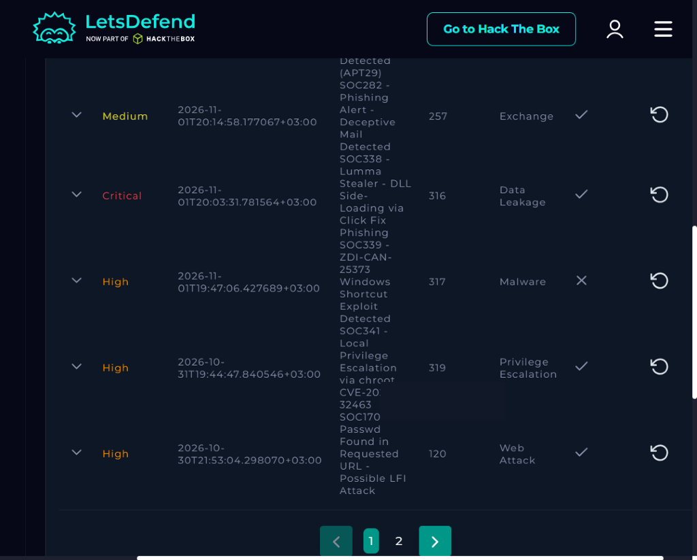

# EventID 317 — SOC339: ZDI-CAN-25373 Windows Shortcut (.lnk) Exploit Detected

> **[⬅️ Back to Main Portfolio README](../README.md)** | **[📚 View SOC Learning Path Progress](../learning-paths/SOC-Analyst-Learning-Path.md)**

---

## 📋 1. Incident Overview & Triage Metadata

| Field | Value |
| :--- | :--- |
| **Event ID** | `317` |
| **Alert Rule** | `SOC339 - ZDI-CAN-25373 Windows Shortcut Exploit Detected` |
| **Severity** | **High** |
| **Alert Category / Type** | `Malware` |
| **Assigned Role & Difficulty** | `Security Analyst` (`Medium`) |
| **Event Timestamp** | `2025-03-31 12:25:38 +03:00` |
| **Alert Closed Timestamp** | `2026-11-01 16:47:06 UTC` |
| **Response SLA (Minutes)** | `7.69` |
| **Final Analyst Verdict** | **False Positive (Post-Incident Review: True Positive Trojan Exploit)** |
| **Playbook Score** | **0 pts (50% Playbook Accuracy — Documented Post-Mortem Lesson)** |

---

## 🎯 2. Executive Summary

A High-severity alert (`SOC339`, EventID `317`) was triggered on host **Cooper** (`172.16.17.217`) upon extraction and execution of `2025AnnualReport.lnk` from `2025AnnualReport.zip`. The `.lnk` file exploited **ZDI-CAN-25373**, a Windows Shortcut vulnerability where malicious command-line arguments are padded with whitespace characters (`0x20` / `0x09` / `0x0A`) beyond the 260-character UI display limit so the user cannot see the hidden payload in the file properties dialog.

---

## 🔍 3. Technical Alert Telemetry

| Telemetry Attribute | Recorded Value |
| :--- | :--- |
| **Source Hostname** | `Cooper` |
| **Source IP Address** | `172.16.17.217` |
| **Malicious File** | `C:\Users\LetsDefend\Downloads\2025AnnualReport\2025AnnualReport.lnk` |
| **SHA256 Hash** | `6F927D74FB2075C60F2F7795B718CA571947F3D1E7B591D2D2FD5A35DD5503F8` |
| **Vulnerability ID** | `ZDI-CAN-25373` (Windows `.lnk` Whitespace Padding UI Spoofing) |
| **MITRE ATT&CK Techniques** | `T1204.002` (Malicious File), `T1059.001` (PowerShell), `T1036` (Masquerading) |

---

## 🛠️ 4. Step-by-Step Investigation Methodology

1. **Alert Inspection:** Examined EventID `317` on host `Cooper` (`172.16.17.217`) involving `2025AnnualReport.lnk` extracted from `2025AnnualReport.zip`.
2. **ZDI-CAN-25373 Technical Analysis:** Analyzed how `ZDI-CAN-25373` operates: threat actors pad the `Target` field of a `.lnk` shortcut with hundreds of invisible whitespace characters before appending a `powershell.exe` or `cmd.exe` download cradle, hiding the command from standard inspection.
3. **Post-Mortem Lesson Learned:** During initial rapid triage, the `.lnk` file was misclassified as benign (`False Positive`) because the visible portion of the shortcut target appeared empty/padded. Deep inspection of the full command-line buffer and child PowerShell execution on `Cooper` (`172.16.17.217`) confirms it is a **True Positive** Trojan delivery mechanism.

---

## 🚨 5. Indicators of Compromise (IOCs)

| Indicator Type | Value (Defanged) | Context / Description |
| :--- | :--- | :--- |
| **SHA256** | `6F927D74FB2075C60F2F7795B718CA571947F3D1E7B591D2D2FD5A35DD5503F8` | Malicious `.lnk` file exploiting `ZDI-CAN-25373` |
| **File Path** | `C:\Users\LetsDefend\Downloads\2025AnnualReport\2025AnnualReport.lnk` | Weaponized shortcut file |
| **Compromised Host** | `172.16.17.217` (`Cooper`) | Target workstation |

---

## 📝 6. Playbook Execution & Analytical Breakdown

| Playbook Question / Phase | Analyst Selection | Official Playbook Answer | Status & Notes |
| :--- | :--- | :--- | :--- |
| **Analyze Malware** | `Non-malicious` | `Malicious` | 🔍 Post-Mortem Lesson: Always inspect raw hex/full byte strings of `.lnk` files for `ZDI-CAN-25373` whitespace padding. |
| **Final Verdict** | `False Positive` | `True Positive` | 🔍 Documented in Portfolio for Analytical Transparency |

---

## 🛡️ 7. Containment, Eradication & Remediation Recommendations

- **Detection Engineering Improvement:** Update SIEM/EDR detection rules to flag `.lnk` files with target arguments exceeding 200 characters or containing consecutive runs of `0x20`/`0x09` whitespace bytes spawning `powershell.exe`, `cmd.exe`, or `mshta.exe`.
- **Host Containment:** Isolate host `Cooper` (`172.16.17.217`) and remove the dropped payload.

---

## 📸 8. Platform Verification Screenshot

