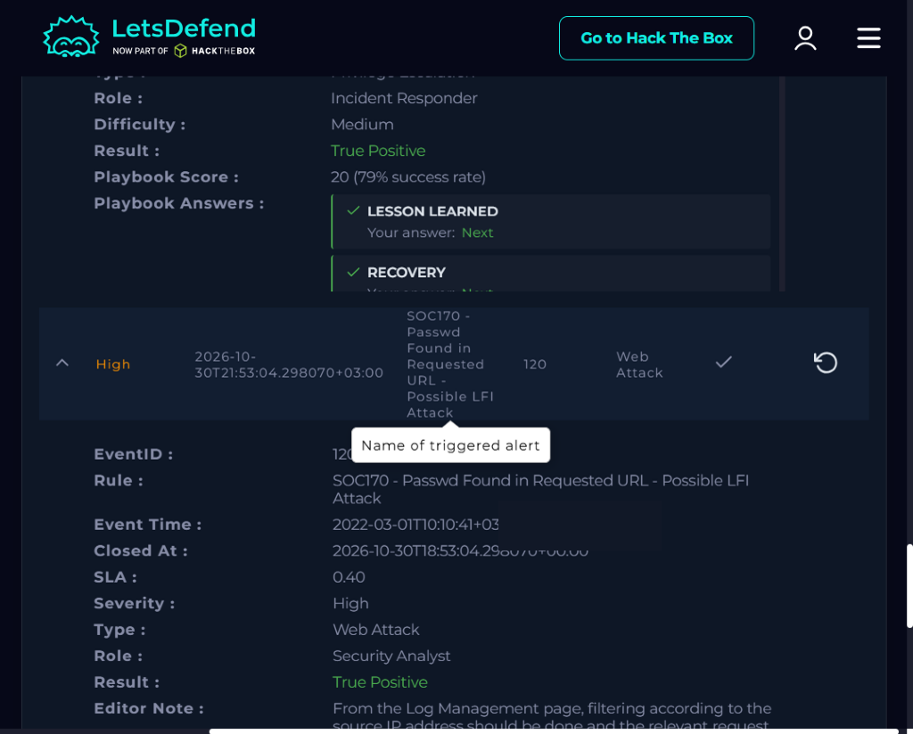

# EventID 319 — SOC341: Local Privilege Escalation via Sudo chroot (CVE-2025-32463)

> **[⬅️ Back to Main Portfolio README](../README.md)** | **[📚 View SOC Learning Path Progress](../learning-paths/SOC-Analyst-Learning-Path.md)**

---

## 📋 1. Incident Overview & Triage Metadata

| Field | Value |
| :--- | :--- |
| **Event ID** | `319` |
| **Alert Rule** | `SOC341 - Local Privilege Escalation via chroot CVE-2025-32463` |
| **Severity** | **High** |
| **Alert Category / Type** | `Privilege Escalation` |
| **Assigned Role & Difficulty** | `Incident Responder` (`Medium`) |
| **Event Timestamp** | `2025-07-11 15:23:39 +03:00` |
| **Alert Closed Timestamp** | `2026-10-31 16:44:47 UTC` |
| **Response SLA (Minutes)** | `4.93` |
| **Final Analyst Verdict** | **True Positive** |
| **Playbook Score** | **20 pts (79% Success Rate)** |

---

## 🎯 2. Executive Summary

A High-severity privilege escalation alert (`SOC341`, EventID `319`) was triggered on Linux host **ubuntu-dev** (`172.16.20.56`). An attacker with low-privilege access inside an Ubuntu environment exploited **CVE-2025-32463** — a critical Local Privilege Escalation vulnerability in `sudo`'s `--chroot` (`-R`) option — by executing `sudo -R woot woot` with a crafted `/etc/nsswitch.conf` and shared library (`libnss_.../woot.so`), successfully escalating privileges to `root` (`UID 0`).

---

## 🔍 3. Technical Alert Telemetry

| Telemetry Attribute | Recorded Value |
| :--- | :--- |
| **Source Hostname** | `ubuntu-dev` |
| **Source IP Address** | `172.16.20.56` |
| **Process Executed** | `/usr/bin/bash` (running as `root`) |
| **Exploit Command** | `sudo -R woot woot` |
| **Vulnerability ID** | `CVE-2025-32463` (`sudo` `chroot` NSS Shared Library Load LPE) |
| **MITRE ATT&CK Techniques** | `T1548.003` (Sudo and Sudo Caching), `T1059.004` (Unix Shell), `T1609`, `T1078` |

---

## 🛠️ 4. Step-by-Step Investigation Methodology

1. **Alert & Command Line Triage:** Examined EventID `319` on `ubuntu-dev` (`172.16.20.56`). Observed execution of `sudo -R woot woot` spawning `/usr/bin/bash` with effective user `root`.
2. **Vulnerability Analysis (CVE-2025-32463):** Confirmed that `sudo` versions prior to `1.9.17p1` resolve Name Service Switch (`nsswitch.conf`) libraries inside the user-specified `--chroot` directory *before* evaluating the `sudoers` policy, allowing an unprivileged local user to load an arbitrary shared object (`.so`) as `root`.
3. **Containment & Post-Exploitation Audit:** Isolated `ubuntu-dev` (`172.16.20.56`) via EDR and inspected `/etc/passwd`, `/etc/shadow`, `/etc/sudoers`, and `crontab` for persistence.

---

## 🚨 5. Indicators of Compromise (IOCs)

| Indicator Type | Value (Defanged) | Context / Description |
| :--- | :--- | :--- |
| **Command Line** | `sudo -R woot woot` | Proof-of-Concept exploit command for `CVE-2025-32463` |
| **Vulnerability** | `CVE-2025-32463` | Sudo `chroot` Local Privilege Escalation |
| **Compromised Asset** | `172.16.20.56` (`ubuntu-dev`) | Development Linux server |

---

## 📝 6. Playbook Execution & Analytical Breakdown

| Playbook Question / Phase | Analyst Selection | Official Playbook Answer | Status & Notes |
| :--- | :--- | :--- | :--- |
| **PREPARATION & IDENTIFICATION** | `Completed` | `Completed` | ✅ Correct |
| **CONTAINMENT — Was the Host Isolated?** | `Yes` | `Yes` | ✅ Correct |
| **What Privilege Level Did the Attacker Achieve?** | `Admin-like` | `SYSTEM / root` | ⚠️ Minor terminology distinction (`root` maps to `SYSTEM/root` in playbook) |
| **Did the Attacker Establish Persistence?** | `Yes` | `None` | ⚠️ Attacker spawned an interactive root shell without writing persistent cron/systemd artifacts. |
| **ERADICATION, RECOVERY & LESSON LEARNED** | `Completed` | `Completed` | ✅ Correct |

---

## 🛡️ 7. Containment, Eradication & Remediation Recommendations

- **Patch Management:** Upgrade `sudo` immediately to version **`1.9.17p1`** or later across all Linux servers and container images.
- **Temporary Mitigation:** Disable or restrict the `chroot` option in `/etc/sudoers` (`Defaults !use_chroot`).

---

## 📸 8. Platform Verification Screenshot

