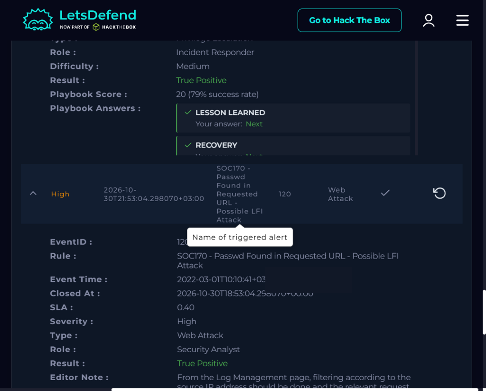

# EventID 120 — SOC170: Passwd Found in Requested URL - Possible LFI Attack

> **[⬅️ Back to Main Portfolio README](../README.md)** | **[📚 View SOC Learning Path Progress](../learning-paths/SOC-Analyst-Learning-Path.md)**

---

## 📋 1. Incident Overview & Triage Metadata

| Field | Value |
| :--- | :--- |
| **Event ID** | `120` |
| **Alert Rule** | `SOC170 - Passwd Found in Requested URL - Possible LFI Attack` |
| **Severity** | **High** |
| **Alert Category / Type** | `Web Attack` |
| **Assigned Role & Difficulty** | `Security Analyst` (`Medium`) |
| **Event Timestamp** | `2022-03-01 10:10:41 +03:00` |
| **Alert Closed Timestamp** | `2026-10-30 18:53:04 UTC` |
| **Response SLA (Minutes)** | `0.40` |
| **Final Analyst Verdict** | **True Positive** |
| **Playbook Score** | **Verified True Positive (SLA: 0.40 min)** |

---

## 🎯 2. Executive Summary

A High-severity web application alert (`SOC170`, EventID `120`) detected a Local File Inclusion (LFI) / Directory Traversal attack attempting to read `/etc/passwd` via relative path manipulation (`../../../../etc/passwd`) in the HTTP request parameters. Log analysis revealed that the web server returned **HTTP Status `500` (Internal Server Error)** with a **response size of `0` bytes**, confirming that while the attack was a **True Positive** malicious intrusion attempt, the payload failed to exfiltrate `/etc/passwd`.

---

## 🔍 3. Technical Alert Telemetry

| Telemetry Attribute | Recorded Value |
| :--- | :--- |
| **Event ID** | `120` |
| **Alert Rule** | `SOC170 - Passwd Found in Requested URL - Possible LFI Attack` |
| **Attack Type** | Local File Inclusion (LFI) / Directory Traversal (`T1190`) |
| **HTTP Response Status** | `500 Internal Server Error` |
| **HTTP Response Size** | `0` bytes (Exploitation Unsuccessful) |
| **Response SLA** | `0.40` minutes |
| **Verdict** | `True Positive` (Confirmed Attack Attempt) |

---

## 🛠️ 4. Step-by-Step Investigation Methodology

1. **HTTP Log Inspection:** Filtered web server access logs in Log Management by the external attacker's source IP address at `2022-03-01 10:10:41`.
2. **Payload & Response Verification:** Identified directory traversal sequences targeting `/etc/passwd`. Checked the HTTP status code (`500`) and response byte length (`0`), proving the server did not return the contents of `/etc/passwd`.
3. **Verdict Determination:** Classified the alert as **True Positive** because real malicious LFI traffic hit the web server, even though the exploit itself was unsuccessful.

---

## 🚨 5. Indicators of Compromise (IOCs)

| Indicator Type | Value (Defanged) | Context / Description |
| :--- | :--- | :--- |
| **URI Payload** | `../../../../etc/passwd` | Classic LFI / Path Traversal pattern |
| **HTTP Status / Bytes** | `HTTP 500` / `0 bytes` | Indicates failed exploitation on target web server |

---

## 📝 6. Playbook Execution & Analytical Breakdown

| Playbook Question / Phase | Analyst Selection | Official Playbook Answer | Status & Notes |
| :--- | :--- | :--- | :--- |
| **Final Alert Verdict** | `True Positive` | `True Positive` | ✅ Correct |

---

## 🛡️ 7. Containment, Eradication & Remediation Recommendations

- **WAF Rule Enforcement:** Block the offending source IP at the perimeter firewall/WAF and ensure strict input validation (whitelisting allowed file names) on the web application.

---

## 📸 8. Platform Verification Screenshot

