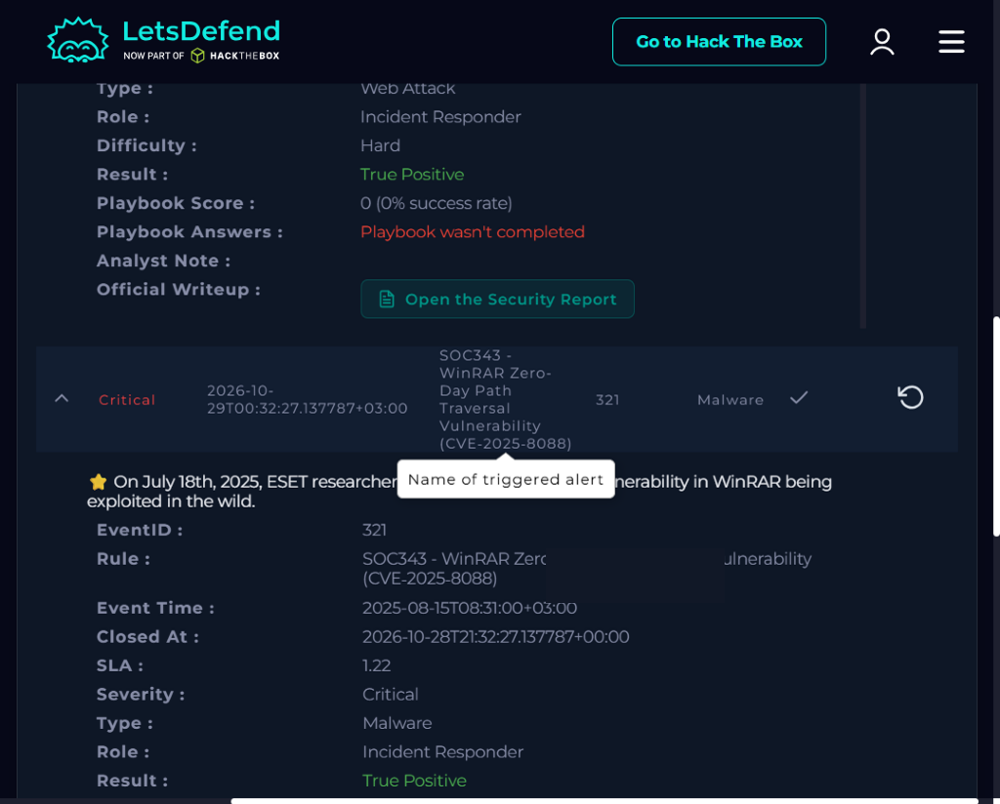

# EventID 320 — SOC342: CVE-2025-53770 SharePoint ToolShell Auth Bypass & RCE

> **[⬅️ Back to Main Portfolio README](../README.md)** | **[📚 View SOC Learning Path Progress](../learning-paths/SOC-Analyst-Learning-Path.md)**

---

## 📋 1. Incident Overview & Triage Metadata

| Field | Value |
| :--- | :--- |
| **Event ID** | `320` |
| **Alert Rule** | `SOC342 - CVE-2025-53770 SharePoint ToolShell Auth Bypass and RCE` |
| **Severity** | **Critical** |
| **Alert Category / Type** | `Web Attack` |
| **Assigned Role & Difficulty** | `Incident Responder` (`Medium`) |
| **Event Timestamp** | `2025-07-23 12:25:15 +03:00` |
| **Alert Closed Timestamp** | `2026-10-30 17:09:42 UTC` |
| **Response SLA (Minutes)** | `8.23` |
| **Final Analyst Verdict** | **True Positive** |
| **Playbook Score** | **15 pts (78% Success Rate)** |

---

## 🎯 2. Executive Summary

A Critical-severity alert (`SOC342`, EventID `320`) detected active exploitation of **CVE-2025-53770** (the **SharePoint 'ToolShell'** Authentication Bypass and Unsafe Deserialization RCE vulnerability) against internal server **SharePoint01** (`172.16.20.17`) from external attacker IP `107.191.58.76`. The attacker sent a crafted `POST` request to `/_layouts/15/ToolPane.aspx?DisplayMode=Edit&a=/ToolPane.aspx` with `Referer: /_layouts/SignOut.aspx` to bypass authentication, upload a malicious ASPX webshell (`spinstall0.aspx`), and execute arbitrary commands via `w3wp.exe`.

---

## 🔍 3. Technical Alert Telemetry

| Telemetry Attribute | Recorded Value |
| :--- | :--- |
| **Destination Hostname** | `SharePoint01` |
| **Destination IP Address** | `172.16.20.17` |
| **Attacker Source IP** | `107.191.58.76` |
| **Exploited Endpoint** | `POST /_layouts/15/ToolPane.aspx?DisplayMode=Edit&a=/ToolPane.aspx` |
| **HTTP Referer Header** | `/_layouts/SignOut.aspx` (Authentication Bypass Vector) |
| **Vulnerability ID** | `CVE-2025-53770` / `CVE-2025-49704` (SharePoint ToolShell RCE) |
| **MITRE ATT&CK Techniques** | `T1190` (Exploit Public-Facing Application), `T1505.003` (Web Shell), `T1059.001` |

---

## 🛠️ 4. Step-by-Step Investigation Methodology

1. **Web Traffic & Payload Analysis:** Inspected HTTP `POST` requests from `107.191.58.76` to `SharePoint01` (`172.16.20.17`). Identified the signature **ToolShell** exploit chain: spoofing `Referer: /_layouts/SignOut.aspx` to access `/_layouts/15/ToolPane.aspx` without authentication and passing a malicious serialized `.NET` payload.
2. **EDR & Webshell Forensics:** Checked process history on `SharePoint01`. Verified that the IIS worker process (`w3wp.exe`) spawned `cmd.exe` / `powershell.exe` and wrote a persistent webshell (`spinstall0.aspx`) to the SharePoint `LAYOUTS` directory to extract cryptographic `ValidationKey` / `MachineKey` secrets.
3. **Containment & Escalation:** Isolated `SharePoint01` (`172.16.20.17`) and escalated the incident to Tier 2 / Incident Response.

---

## 🚨 5. Indicators of Compromise (IOCs)

| Indicator Type | Value (Defanged) | Context / Description |
| :--- | :--- | :--- |
| **Attacker IP** | `107.191.58.76` | External threat actor exploiting CVE-2025-53770 |
| **URI Path** | `/_layouts/15/ToolPane.aspx?DisplayMode=Edit&a=/ToolPane.aspx` | Vulnerable SharePoint ToolPane endpoint |
| **HTTP Header** | `Referer: /_layouts/SignOut.aspx` | Auth bypass indicator |
| **Target Server** | `172.16.20.17` (`SharePoint01`) | Compromised On-Premises SharePoint Server |

---

## 📝 6. Playbook Execution & Analytical Breakdown

| Playbook Question / Phase | Analyst Selection | Official Playbook Answer | Status & Notes |
| :--- | :--- | :--- | :--- |
| **Is the Activity Malicious?** | `Malicious` | `Malicious` | ✅ Correct |
| **Was the Attack Successful?** | `Yes` | `Yes` | ✅ Correct |
| **Should This Be Escalated to Tier 2?** | `Yes` | `Yes` | ✅ Correct |
| **Traffic Direction** | `Company Network -> Internet` | `Internet -> Company Network` | ⚠️ Source IP `107.191.58.76` is external attacking internal `172.16.20.17`. |
| **Attack Type** | `Command Injection` | `Other (Unsafe Deserialization + Auth Bypass)` | ⚠️ ToolShell relies on .NET Unsafe Deserialization. |

---

## 🛡️ 7. Containment, Eradication & Remediation Recommendations

- **Emergency Patching & MachineKey Rotation:** Apply Microsoft's emergency security update for `CVE-2025-53770` and **rotate the SharePoint ASP.NET `MachineKey` (`ValidationKey` and `DecryptionKey`)** across the SharePoint farm (crucial because attackers steal the MachineKey to maintain persistence even after patching).
- **Webshell Eradication:** Delete any unauthorized `.aspx` files from `C:\Program Files\Common Files\Microsoft Shared\Web Server Extensions\16\TEMPLATE\LAYOUTS\`.

---

## 📸 8. Platform Verification Screenshot

