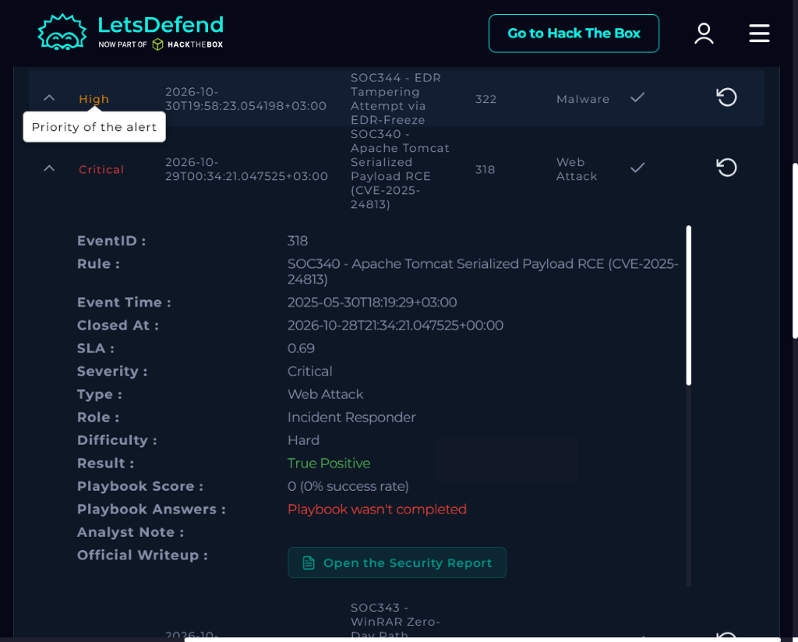

# EventID 322 — SOC344: EDR Tampering Attempt via EDR-Freeze

> **[⬅️ Back to Main Portfolio README](../README.md)** | **[📚 View SOC Learning Path Progress](../learning-paths/SOC-Analyst-Learning-Path.md)**

---

## 📋 1. Incident Overview & Triage Metadata

| Field | Value |
| :--- | :--- |
| **Event ID** | `322` |
| **Alert Rule** | `SOC344 - EDR Tampering Attempt via EDR-Freeze` |
| **Severity** | **High** |
| **Alert Category / Type** | `Malware` |
| **Assigned Role & Difficulty** | `Incident Responder` (`Medium`) |
| **Event Timestamp** | `2025-09-25 14:43:39 +03:00` |
| **Alert Closed Timestamp** | `2026-10-30 16:58:23 UTC` |
| **Response SLA (Minutes)** | `1.77` |
| **Final Analyst Verdict** | **True Positive** |
| **Playbook Score** | **20 pts (85% Success Rate)** |

---

## 🎯 2. Executive Summary

A High-severity defense evasion alert (`SOC344`, EventID `322`) was triggered on production workstation **WS-Prod-02** (`172.16.20.69`). The attacker executed `"C:\Users\LetsDefend\Downloads\EDR-Freeze_1.0.exe" 6080 10000` to suspend/freeze the Microsoft Defender / EDR sensor process (`PID 6080`, `MsMpEng.exe`) for `10,000` milliseconds by abusing `WerFaultSecure.exe` (Windows Error Reporting Protected Process Light - PPL) to hold open thread handles (`MiniDumpWriteDump` / thread suspension technique).

---

## 🔍 3. Technical Alert Telemetry

| Telemetry Attribute | Recorded Value |
| :--- | :--- |
| **Source Hostname** | `WS-Prod-02` |
| **Source IP Address** | `172.16.20.69` |
| **Command Line** | `"C:\Users\LetsDefend\Downloads\EDR-Freeze_1.0.exe" 6080 10000` |
| **SHA256 Hash** | `970c7834e58b6ef22473875167a333dbb33bf7b667d1cb814829f68579cd85f7` |
| **Targeted Process ID** | `PID 6080` (`MsMpEng.exe` — Microsoft Defender Antivirus Service) |
| **MITRE ATT&CK Techniques** | `T1562.001` (Impair Defenses: Disable or Modify Tools), `T1055`, `T1489`, `T1059.001` |

---

## 🛠️ 4. Step-by-Step Investigation Methodology

1. **Alert & Command Line Forensics:** Analyzed EventID `322` on `WS-Prod-02` (`172.16.20.69`) within `1.77` minutes SLA. Identified execution of `EDR-Freeze_1.0.exe` targeting `PID 6080` for `10000` ms.
2. **EDR Process Tree Verification:** Checked `PID 6080` on `WS-Prod-02`, confirming it belonged to `MsMpEng.exe` (Microsoft Defender). Observed `EDR-Freeze_1.0.exe` spawning `WerFaultSecure.exe` as a PPL process to suspend `MsMpEng.exe` threads without requiring a vulnerable kernel driver (BYOVD).
3. **Containment:** Isolated `WS-Prod-02` (`172.16.20.69`) and verified that no other hosts on the network executed `970c7834e58b6ef22473875167a333dbb33bf7b667d1cb814829f68579cd85f7`.

---

## 🚨 5. Indicators of Compromise (IOCs)

| Indicator Type | Value (Defanged) | Context / Description |
| :--- | :--- | :--- |
| **SHA256** | `970c7834e58b6ef22473875167a333dbb33bf7b667d1cb814829f68579cd85f7` | `EDR-Freeze_1.0.exe` binary |
| **Command Line** | `"C:\Users\LetsDefend\Downloads\EDR-Freeze_1.0.exe" 6080 10000` | Freezes PID 6080 (`MsMpEng.exe`) for 10 seconds |
| **Compromised Host** | `172.16.20.69` (`WS-Prod-02`) | Production workstation |

---

## 📝 6. Playbook Execution & Analytical Breakdown

| Playbook Question / Phase | Analyst Selection | Official Playbook Answer | Status & Notes |
| :--- | :--- | :--- | :--- |
| **PREPARATION & IDENTIFICATION** | `Completed` | `Completed` | ✅ Correct |
| **CONTAINMENT — Isolate Host `WS-Prod-02`** | `Isolated` | `Isolated` | ✅ Correct |
| **Were Other Systems Compromised?** | `Yes` | `No` | ⚠️ Activity was scoped exclusively to `WS-Prod-02` (`172.16.20.69`). |
| **Primary Defense Evasion MITRE Technique** | `Access Token Manipulation` | `Impair Defenses (T1562.001)` | ⚠️ Freezing an EDR process maps to `T1562.001`. |
| **ERADICATION, RECOVERY & LESSON LEARNED** | `Completed` | `Completed` | ✅ Correct (85% Overall Score) |

---

## 🛡️ 7. Containment, Eradication & Remediation Recommendations

- **Behavioral Detection Rule:** Create a SIEM/EDR correlation rule alerting whenever `WerFaultSecure.exe` is invoked with command-line flags targeting the PID of an active security sensor (`MsMpEng.exe`, `SenseIR.exe`, `CrowdStrike`, `SentinelAgent`) from a non-system parent process.

---

## 📸 8. Platform Verification Screenshot

