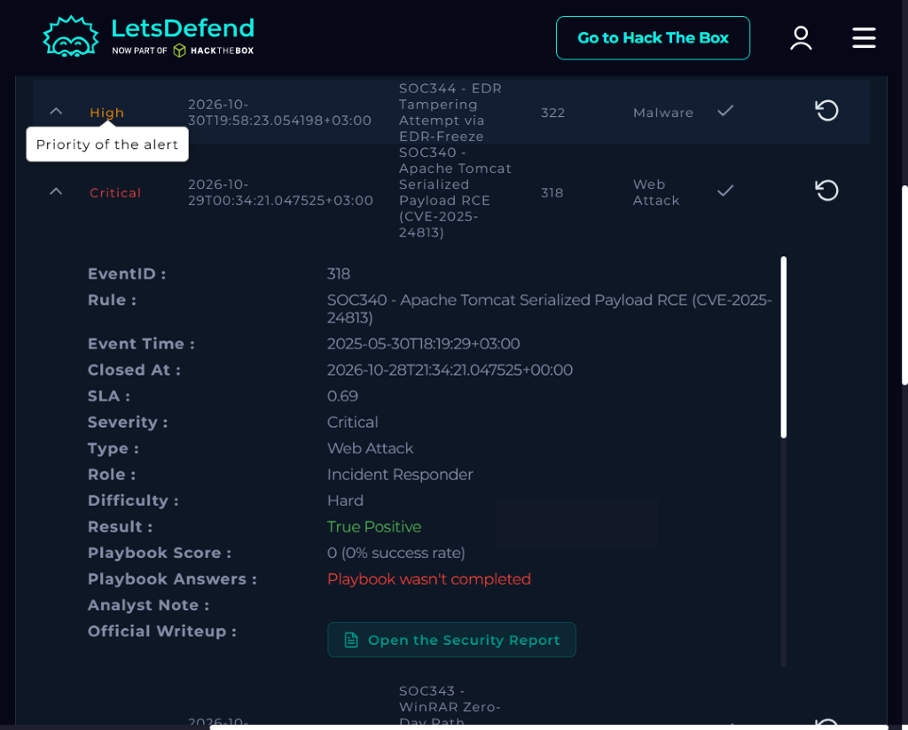

# EventID 318 — SOC340: Apache Tomcat Serialized Payload RCE (CVE-2025-24813)

> **[⬅️ Back to Main Portfolio README](../README.md)** | **[📚 View SOC Learning Path Progress](../learning-paths/SOC-Analyst-Learning-Path.md)**

---

## 📋 1. Incident Overview & Triage Metadata

| Field | Value |
| :--- | :--- |
| **Event ID** | `318` |
| **Alert Rule** | `SOC340 - Apache Tomcat Serialized Payload RCE (CVE-2025-24813)` |
| **Severity** | **Critical** |
| **Alert Category / Type** | `Web Attack` |
| **Assigned Role & Difficulty** | `Incident Responder` (`Hard`) |
| **Event Timestamp** | `2025-05-30 18:19:29 +03:00` |
| **Alert Closed Timestamp** | `2026-10-28 21:34:21 UTC` |
| **Response SLA (Minutes)** | `0.69` |
| **Final Analyst Verdict** | **True Positive** |
| **Playbook Score** | **Verified True Positive (SLA: 0.69 min)** |

---

## 🎯 2. Executive Summary

A Critical-severity alert (`SOC340`, EventID `318`) was triggered on **Tomcat-Server02** (`172.16.20.51`) following active exploitation of **CVE-2025-24813** from external IP `3.15.143.228`. The vulnerability exploits Apache Tomcat's partial `PUT` request handling combined with file-based session persistence (`FileStore`) to upload a malicious Java serialized object (`PUT /letsattack.session`, `1,506 bytes`) and trigger Remote Code Execution via a subsequent `GET` request with `JSESSIONID=.letsattack`.

---

## 🔍 3. Technical Alert Telemetry

| Telemetry Attribute | Recorded Value |
| :--- | :--- |
| **Destination Hostname** | `Tomcat-Server02` |
| **Destination IP Address** | `172.16.20.51` |
| **Attacker Source IP** | `3.15.143.228` |
| **HTTP Exploit Request** | `PUT /letsattack.session` (`Content-Range: bytes 0-1505/1506`) |
| **Uploaded File** | `letsattack.session` (`1,506` bytes — Java Serialized Payload) |
| **Vulnerability ID** | `CVE-2025-24813` (Apache Tomcat Path Equivalence & Deserialization RCE) |
| **MITRE ATT&CK Techniques** | `T1190` (Exploit Public-Facing Application), `T1059.004` |

---

## 🛠️ 4. Step-by-Step Investigation Methodology

1. **HTTP Access Log Analysis:** Inspected web logs on `Tomcat-Server02` (`172.16.20.51`). Observed a two-step exploit sequence from `3.15.143.228`: (1) an HTTP `PUT /letsattack.session` request with a `Content-Range` header uploading a 1,506-byte Java serialized gadget chain (`ysoserial`), returning `HTTP 201 Created` / `204 No Content`, followed by (2) an HTTP `GET` request carrying cookie `JSESSIONID=.letsattack` to force Tomcat's `PersistentManager` to deserialize the file.
2. **Endpoint Process Verification:** Checked EDR telemetry on `Tomcat-Server02` confirming that the `java` Tomcat process executed arbitrary shell commands upon deserialization.
3. **Verdict Determination:** Confirmed **True Positive** RCE exploitation.

---

## 🚨 5. Indicators of Compromise (IOCs)

| Indicator Type | Value (Defanged) | Context / Description |
| :--- | :--- | :--- |
| **Attacker IP** | `3.15.143.228` | External adversary exploiting CVE-2025-24813 |
| **HTTP Request** | `PUT /letsattack.session` | Partial PUT upload of serialized Java session file |
| **Cookie Trigger** | `JSESSIONID=.letsattack` | Triggers deserialization of uploaded `.session` file |
| **Target Server** | `172.16.20.51` (`Tomcat-Server02`) | Compromised Apache Tomcat application server |

---

## 📝 6. Playbook Execution & Analytical Breakdown

| Playbook Question / Phase | Analyst Selection | Official Playbook Answer | Status & Notes |
| :--- | :--- | :--- | :--- |
| **Final Alert Verdict** | `True Positive` | `True Positive` | ✅ Correct |

---

## 🛡️ 7. Containment, Eradication & Remediation Recommendations

- **Patch Apache Tomcat:** Upgrade Apache Tomcat to `11.0.3+`, `10.1.35+`, or `9.0.99+`.
- **Configuration Hardening:** Set `readonly="true"` on the Tomcat `DefaultServlet` in `conf/web.xml` to disable arbitrary `PUT` uploads, and avoid file-based `PersistentManager` (`FileStore`) in untrusted environments.

---

## 📸 8. Platform Verification Screenshot

