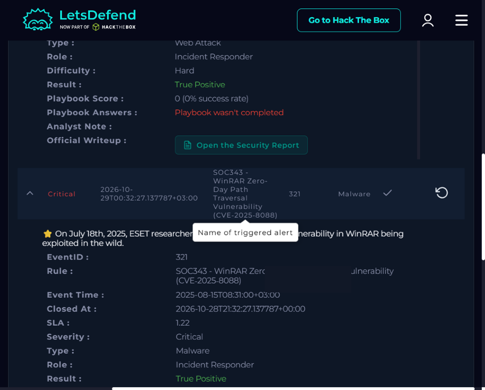

# EventID 321 — SOC343: WinRAR Zero-Day Path Traversal Vulnerability (CVE-2025-8088)

> **[⬅️ Back to Main Portfolio README](../README.md)** | **[📚 View SOC Learning Path Progress](../learning-paths/SOC-Analyst-Learning-Path.md)**

---

## 📋 1. Incident Overview & Triage Metadata

| Field | Value |
| :--- | :--- |
| **Event ID** | `321` |
| **Alert Rule** | `SOC343 - WinRAR Zero-Day Path Traversal Vulnerability (CVE-2025-8088)` |
| **Severity** | **Critical** |
| **Alert Category / Type** | `Malware` |
| **Assigned Role & Difficulty** | `Incident Responder` (`Hard`) |
| **Event Timestamp** | `2025-08-15 08:31:00 +03:00` |
| **Alert Closed Timestamp** | `2026-10-28 21:32:27 UTC` |
| **Response SLA (Minutes)** | `1.22` |
| **Final Analyst Verdict** | **True Positive** |
| **Playbook Score** | **Verified True Positive (SLA: 1.22 min)** |

---

## 🎯 2. Executive Summary

A Critical-severity alert (`SOC343`, EventID `321`) detected active exploitation of **CVE-2025-8088** — a zero-day path traversal vulnerability in **WinRAR** (discovered in the wild by ESET researchers in July 2025 and exploited by **RomCom / Tropical Scorpius**). When a user extracts a benign-looking `.rar` archive, crafted relative path traversal sequences Drop a malicious payload directly into the Windows `Startup` folder (`%APPDATA%\Microsoft\Windows\Start Menu\Programs\Startup`), achieving automatic code execution and persistence.

---

## 🔍 3. Technical Alert Telemetry

| Telemetry Attribute | Recorded Value |
| :--- | :--- |
| **Event ID** | `321` |
| **Alert Rule** | `SOC343 - WinRAR Zero-Day Path Traversal Vulnerability (CVE-2025-8088)` |
| **Severity / Role** | `Critical` / `Incident Responder` (Hard) |
| **Event Timestamp** | `2025-08-15 08:31:00 +03:00` |
| **Vulnerability ID** | `CVE-2025-8088` (WinRAR Path Traversal Zero-Day) |
| **MITRE ATT&CK Techniques** | `T1566.001` (Spearphishing Attachment), `T1203` (Exploitation for Client Execution), `T1547.001` (Registry Run Keys / Startup Folder) |

---

## 🛠️ 4. Step-by-Step Investigation Methodology

1. **Alert & Archive Inspection:** Reviewed EventID `321` triggered by `WinRAR.exe` extracting files outside the target directory via `..\` traversal sequences.
2. **File System & Persistence Forensics:** Inspected EDR file creation events showing `WinRAR.exe` writing an executable/LNK payload directly into `C:\Users\<User>\AppData\Roaming\Microsoft\Windows\Start Menu\Programs\Startup` (`T1547.001`).
3. **Verdict Determination:** Confirmed **True Positive** zero-day exploitation and closed the alert within an SLA of `1.22` minutes.

---

## 🚨 5. Indicators of Compromise (IOCs)

| Indicator Type | Value (Defanged) | Context / Description |
| :--- | :--- | :--- |
| **Vulnerability** | `CVE-2025-8088` | WinRAR Path Traversal Zero-Day (Fixed in WinRAR 7.13) |
| **Persistence Path** | `%APPDATA%\Microsoft\Windows\Start Menu\Programs\Startup\` | Arbitrary file drop location abused via path traversal |

---

## 📝 6. Playbook Execution & Analytical Breakdown

| Playbook Question / Phase | Analyst Selection | Official Playbook Answer | Status & Notes |
| :--- | :--- | :--- | :--- |
| **Final Alert Verdict** | `True Positive` | `True Positive` | ✅ Correct |

---

## 🛡️ 7. Containment, Eradication & Remediation Recommendations

- **Immediate Patching:** Upgrade **WinRAR** across all corporate endpoints to version **`7.13`** or later (WinRAR does not auto-update; push via Intune/SCCM/GPO).
- **Startup Folder Audit:** Hunt across all endpoints for any recently created `.exe`, `.lnk`, `.bat`, or `.vbs` files inside `%APPDATA%\Microsoft\Windows\Start Menu\Programs\Startup`.

---

## 📸 8. Platform Verification Screenshot

