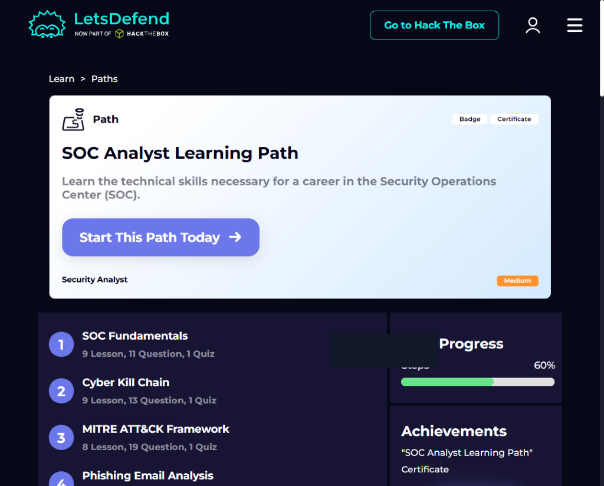
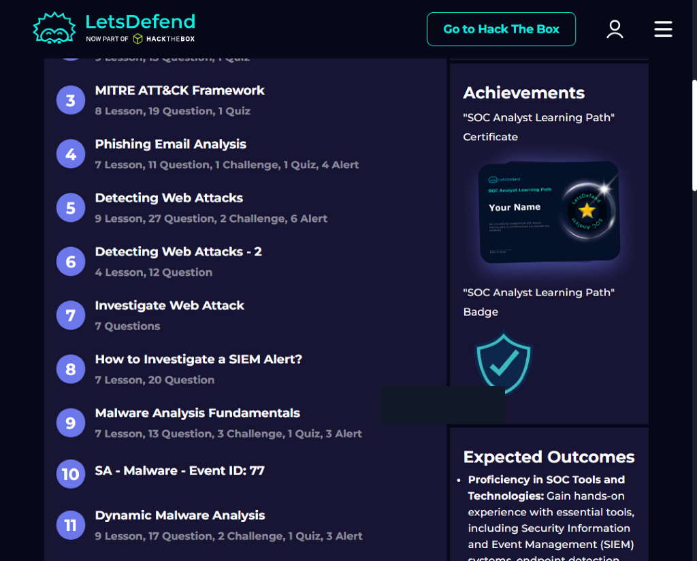
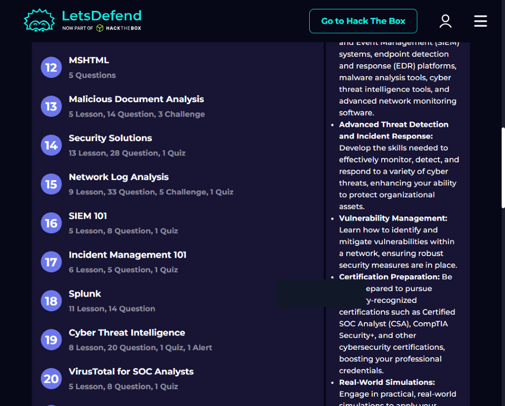
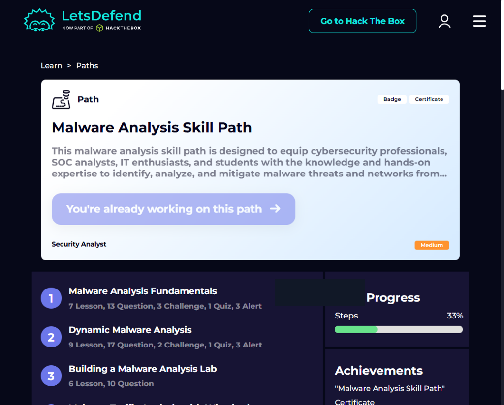
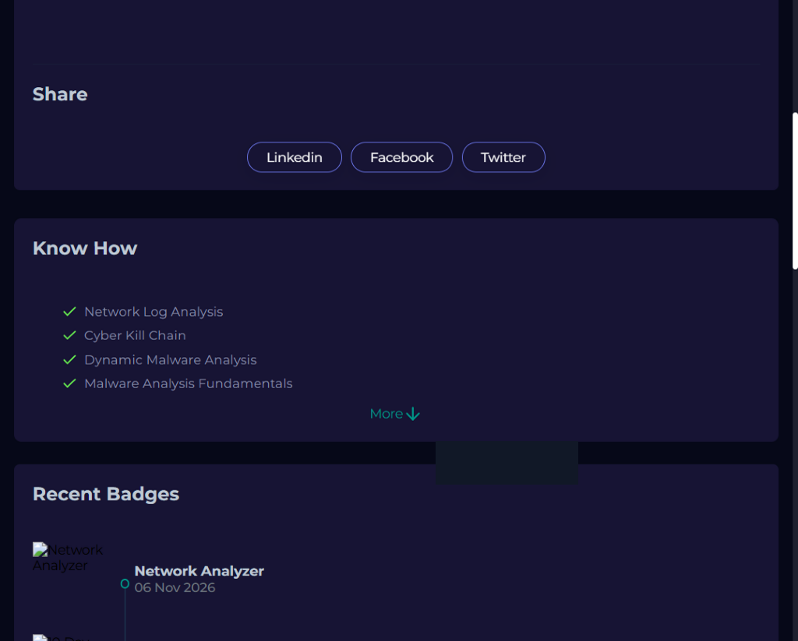
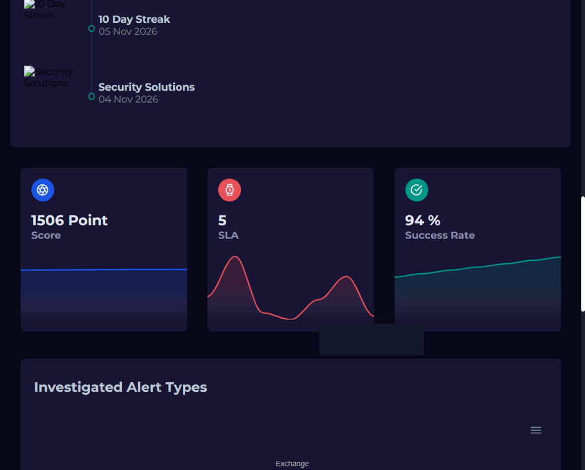
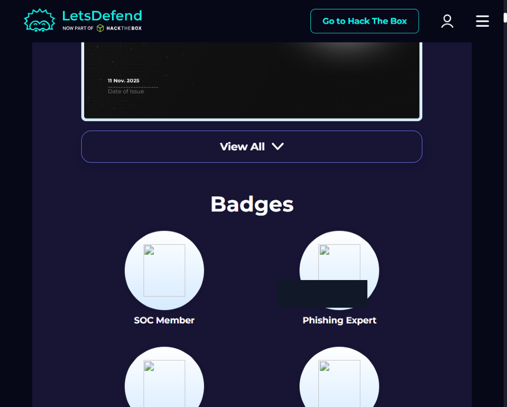

# SOC Analyst & Malware Analysis Learning Paths

This document serves as a comprehensive reference of my structured training and module completions on **LetsDefend** across both the **SOC Analyst Learning Path** and the **Malware Analysis Skill Path**.

---

## 📊 Executive Training Summary

| Metric | Details |
| :--- | :--- |
| **Analyst Handle** | `mohmmad234` |
| **Total Platform Score** | **1,506 Points** |
| **Alert Triage Accuracy** | **94% Success Rate** |
| **Average SLA Metric** | **5** |
| **SOC Analyst Learning Path Progress** | **60% Completed** (15 / 25 Modules Completed) |
| **Malware Analysis Skill Path Progress** | **33% Completed** (3 / 9 Modules Active/Completed) |
| **Unlocked Platform Badges** | **15 Verified Badges** |

---

## 🛡️ 1. SOC Analyst Learning Path (60% Completed — 15/25 Modules)

The **SOC Analyst Learning Path** equips security analysts with practical, hands-on skills across SIEM alert triage, phishing investigation, web attack detection, endpoint security, and network log analysis.

### ✅ Completed Modules (15 / 25)

| # | Module Name | Structure & Deliverables | Key Technical Competencies Mastered | Status |
| :-: | :--- | :--- | :--- | :-: |
| **01** | **SOC Fundamentals** | 9 Lessons, 11 Questions, 1 Quiz | SOC organizational tiers (L1/L2/L3), SIEM/EDR/SOAR architecture, SLA management, and alert triage workflows. | ✅ Completed |
| **02** | **Cyber Kill Chain** | 9 Lessons, 13 Questions, 1 Quiz | Lockheed Martin's 7-stage intrusion model: Reconnaissance, Weaponization, Delivery, Exploitation, Installation, C2, and Actions on Objectives. | ✅ Completed |
| **03** | **MITRE ATT&CK Framework** | 8 Lessons, 19 Questions, 1 Quiz | Mapping adversary Tactics, Techniques, and Procedures (TTPs), sub-techniques, threat group profiling (e.g., APT29), and MITRE Navigator usage. | ✅ Completed |
| **04** | **Phishing Email Analysis** | 7 Lessons, 11 Questions, 1 Challenge, 1 Quiz, 4 Alerts | SMTP header forensics (`SPF`, `DKIM`, `DMARC`, `Return-Path`, `Received`), spoofed sender detection, malicious attachment sandboxing, and URL defanging. | ✅ Completed |
| **05** | **Detecting Web Attacks** | 9 Lessons, 27 Questions, 2 Challenges, 6 Alerts | Identifying SQL Injection (SQLi), Cross-Site Scripting (XSS), Local/Remote File Inclusion (LFI/RFI), Command Injection, and IDOR in HTTP access logs. | ✅ Completed |
| **06** | **Detecting Web Attacks - 2** | 4 Lessons, 12 Questions | Advanced web exploitation patterns, HTTP response code/byte-size analysis to distinguish attempted vs. successful exploitation, and webshell detection. | ✅ Completed |
| **07** | **Investigate Web Attack** | 7 Practical Questions | End-to-end practical web attack investigation correlating firewall/proxy logs with web server access logs. | ✅ Completed |
| **08** | **How to Investigate a SIEM Alert?** | 7 Lessons, 20 Questions | Standardized SIEM investigation methodology: rule logic analysis, asset context verification, log correlation, Threat Intelligence enrichment, and True/False Positive determination. | ✅ Completed |
| **09** | **Malware Analysis Fundamentals** | 7 Lessons, 13 Questions, 3 Challenges, 1 Quiz, 3 Alerts | File hashing (MD5/SHA256), PE header inspection, static string extraction, OSINT reputation checks (VirusTotal, Hybrid Analysis), and sandbox triage. | ✅ Completed |
| **10** | **SA - Malware - Event ID: 77** | Practical Simulated Alert | Full investigation of macro-enabled Excel malware (`ORDER SHEET & SPEC.xlsm`), C2 callback verification, and endpoint containment assessment. | ✅ Completed |
| **11** | **Dynamic Malware Analysis** | 9 Lessons, 17 Questions, 2 Challenges, 1 Quiz, 3 Alerts | Behavioral monitoring in isolated sandboxes: process tree creation, registry modifications (`Run` keys), file system artifacts, DLL side-loading, and network C2 beacons. | ✅ Completed |
| **12** | **MSHTML** | 5 Practical Questions | Analysis of CVE-2021-40444 MSHTML engine exploitation via crafted Office documents and ActiveX controls. | ✅ Completed |
| **13** | **Malicious Document Analysis** | 5 Lessons, 14 Questions, 3 Challenges | Inspecting OLE2 (`oledump`, `olevba`) and OOXML structures, extracting obfuscated VBA macros, analyzing embedded streams, and identifying shellcode droppers. | ✅ Completed |
| **14** | **Security Solutions** | 13 Lessons, 28 Questions, 1 Quiz | Deep dive into enterprise defense stack: Firewall, IDS/IPS, WAF, Web Proxy, EDR/XDR, DLP, and Email Security Gateways. | ✅ Completed |
| **15** | **Network Log Analysis** | 9 Lessons, 33 Questions, 5 Challenges, 1 Quiz | Analyzing PCAPs, Zeek/Suricata logs, DNS exfiltration, HTTP/HTTPS proxy logs, anomalous port traffic, and lateral movement indicators. | ✅ Completed |

---

### ⏳ Upcoming / Remaining Modules in SOC Analyst Path (10 / 25)

| # | Module Name | Curriculum Scope | Status |
| :-: | :--- | :--- | :-: |
| **16** | **SIEM 101** | 5 Lessons, 8 Questions, 1 Quiz | 🔜 Queued |
| **17** | **Incident Management 101** | 6 Lessons, 5 Questions, 1 Quiz | 🔜 Queued |
| **18** | **Splunk** | 11 Lessons, 14 Questions | 🔜 Queued |
| **19** | **Cyber Threat Intelligence** | 8 Lessons, 20 Questions, 1 Quiz, 1 Alert | 🔜 Queued |
| **20** | **VirusTotal for SOC Analysts** | 5 Lessons, 8 Questions, 1 Quiz | 🔜 Queued |
| **21** | **SA - Malware - Event ID: 76** | Practical Simulated Alert | 🔜 Queued |
| **22** | **IT Security Basis for Corporates** | 10 Lessons, 4 Questions, 1 Quiz | 🔜 Queued |
| **23** | **Detecting Brute Force Attacks** | 8 Lessons, 4 Questions, 1 Challenge, 1 Quiz | 🔜 Queued |
| **24** | **Building a Malware Analysis Lab** | 6 Lessons, 10 Questions | 🔄 In Progress |
| **25** | **Building a SOC Lab at Home** | 5 Lessons, 5 Questions | 🔜 Queued |

---

## 🧬 2. Malware Analysis Skill Path (33% Completed — 3/9 Modules)

| # | Module Name | Curriculum Scope | Status |
| :-: | :--- | :--- | :-: |
| **01** | **Malware Analysis Fundamentals** | 7 Lessons, 13 Questions, 3 Challenges, 1 Quiz, 3 Alerts | ✅ Completed |
| **02** | **Dynamic Malware Analysis** | 9 Lessons, 17 Questions, 2 Challenges, 1 Quiz, 3 Alerts | ✅ Completed |
| **03** | **Building a Malware Analysis Lab** | 6 Lessons, 10 Questions | 🔄 In Progress |
| **04** | **Malware Traffic Analysis with Wireshark** | Network Forensics & PCAP Inspection | 🔜 Queued |
| **05** | **Static Malware Analysis** | PE Disassembly & Binary Inspection | 🔜 Queued |
| **06** | **Malicious Document Analysis** | 5 Lessons, 14 Questions, 3 Challenges (Completed via SOC Path) | ✅ Completed |
| **07** | **Reverse Engineering** | Assembly & Debugger Fundamentals | 🔜 Queued |
| **08** | **Reverse Engineering 2** | Advanced Unpacking & Anti-Analysis Evasion | 🔜 Queued |
| **09** | **VirusTotal for SOC Analysts** | VTI Hunting, YARA & Graph Relationships | 🔜 Queued |

---

## 🏅 3. Verified Badges & Achievements (15 Total)

| # | Badge Title | Domain / Competency |
| :-: | :--- | :--- |
| 1 | **SOC Member** | Core SOC Operations & Alert Triage Fundamentals |
| 2 | **Phishing Expert** | Email Header Forensics, Attachment & Spoofing Analysis |
| 3 | **Web Attack Investigator** | OWASP Top 10 Detection & HTTP Log Triage |
| 4 | **Web Attack Investigated** | Advanced Web Exploitation & Server Log Analysis |
| 5 | **Web Hunter** | Practical Web Intrusion Hunting & Payload Identification |
| 6 | **Malware Analyzer** | Static/Dynamic Triage & Indicator Extraction |
| 7 | **Dynamic Analyst** | Behavioral Sandboxing, Process & Network Monitoring |
| 8 | **Office Document Analyzer** | Malicious Macro (`.xlsm`/`.docm`) & OLE Stream Analysis |
| 9 | **MSHTML Analyzer** | CVE-2021-40444 & ActiveX Exploit Forensics |
| 10 | **Network Analyzer** | Packet Capture (PCAP), Proxy, DNS & Firewall Log Forensics |
| 11 | **Security Solutions** | Enterprise Defense Architecture (EDR, WAF, IDS/IPS, DLP) |
| 12 | **MITRE ATT&CK** | Adversary TTP Mapping & Threat Modeling |
| 13 | **Cyber Kill Chain** | End-to-End Intrusion Lifecycle Analysis |
| 14 | **How to Investigate a SIEM Alert?** | Structured SIEM Triage & Incident Escalation |
| 15 | **10 Day Streak** | Continuous Hands-On SOC Investigation Consistency |

### Visual Evidence of Skills & Badges

